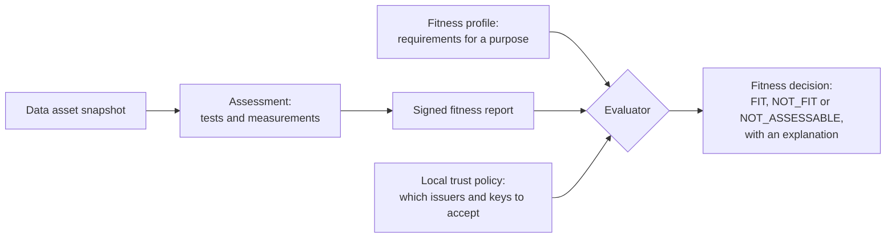

# Open Fitness Framework (OFF) Specification

**Is this data good enough for what I want to do with it?**

The Open Fitness Framework gives people and software agents a shared, verifiable way to answer that question. It lets you state what a particular use of data requires, collect signed evidence about a specific version of a data asset, and reach a decision that is reproducible and explains itself.

📄 **Read the specification:** [Open Fitness Framework Specification, version 0.3 draft](/spec/0.3/open-fitness-framework-spec.md)

🌲 **Prefer to see an example?** [Follow an agent as it selects aerial imagery for training a tree-vitality model](/spec/0.3/guide/tree-vitality-orthoimagery.md), step by step from profile to decision, or [watch a national INSPIRE coordinator check a road network](/spec/0.3/guide/inspire-road-network.md) for schema validity, topology and codelist values.

> [!IMPORTANT]
> This is a **working draft** (version 0.3), published for review and discussion. Its requirements are proposals, not an adopted community standard, and details will change before a 1.0 release.

## Why OFF?

There is no such thing as "good data" in general. A building dataset that is complete enough for a city overview map may be far too incomplete for a flood-risk model. Data is only ever fit *for a purpose*.

Plenty of evidence about data already exists: schema validation results, quality measurements, certificates, expert reviews, and reports that a dataset worked well in a particular workflow. What is missing is a common way to bring that evidence together. Today, anyone deciding whether to rely on a dataset has to work out, mostly by hand:

- whether a piece of evidence really describes *this exact version* of the data, or an older copy or a different format;
- who produced it, how it was produced, and whether they trust that source;
- whether the measured values actually meet the needs of their use case;
- what to conclude when evidence is missing, out of date, or contradictory.

This gets harder as AI agents increasingly discover and use data on their own. An agent needs clear rules it can apply, and it must not paper over gaps by guessing that two similar-sounding things are equivalent, or that a missing check probably passed.

OFF addresses this by making requirements, evidence, trust and decisions explicit and machine-readable.

## How it works

OFF is built around three kinds of objects:

- A **fitness profile** states what a purpose requires, for example "height values must be at least 98% complete, and the data must conform to schema X".
- A **fitness report** is a digitally signed credential containing test results or quality measurements about one exact snapshot of a data asset.
- A **fitness decision** is produced by an evaluator. It applies a profile to the available reports under a local trust policy, and records the result together with the reasons behind it.

### A short example

Take a dataset of 1,000 building records in which 987 have a height value. An assessor measures height completeness as 0.987 and also confirms that the records conform to the required schema. Both results are signed into a report.

- A profile for a purpose that needs at least 98% completeness evaluates the report as **FIT**.
- A profile for a purpose that needs at least 99.5% completeness evaluates the same report as **NOT_FIT**.

The measurement is made once and reused. Only the requirements differ, because they belong to the purpose, not to the data. (See [Section 15.2](spec/0.3/open-fitness-framework-spec.md#152-illustrative-example-and-companion-status) of the specification.)

## What the specification contributes

**Purpose-specific decisions.** Every profile names the purpose it serves. A decision says whether the declared requirements for that purpose are met; it never claims that data is good in general.

**Evidence kept separate from thresholds.** Reports record what was observed; profiles decide what is good enough. One measurement can therefore serve many purposes without being redone.

**Evidence tied to an exact version of the data.** Each report is bound to one immutable snapshot of a data asset through a cryptographic digest. Evidence about last year's version, or about a different file format of the same dataset, does not silently carry over.

**Verifiable origin, without over-claiming.** Reports use W3C Verifiable Credentials with a single, concrete signature format. OFF is explicit that a valid signature proves who made a claim and that it has not been altered, but not that the claim is true. Which issuers to trust, and for which kinds of claims, is set out in a trust policy that each evaluator controls.

**Honest outcomes.** For each requirement, an evaluator reports PASS, FAIL, UNKNOWN or CONFLICT. For the whole profile, the result is FIT, NOT_FIT or NOT_ASSESSABLE. Missing evidence is never treated as a pass, a crashed validator is never treated as a failure, and contradicting reports are surfaced rather than quietly resolved.

**Reproducible and explainable.** The evaluation procedure is deterministic: the same inputs always lead to the same decision, whatever order reports arrive in. Every decision records which evidence was accepted, which was excluded, and why.

**A small core, with extensions.** A minimal implementation can work entirely offline with locally supplied files: no central registry, RDF store or network service is needed. Optional extensions add capabilities such as sampled assessments, alternative requirements, credential revocation, and replay of past evaluations, without making the core harder to implement.

## Built on existing standards

OFF does not reinvent what already works. It adopts and connects established specifications, and adds the missing piece: rules for when evidence is acceptable and how it leads to a decision for a given purpose.

| Standard                                                                                   | Role in OFF                                                                       |
| ------------------------------------------------------------------------------------------ | --------------------------------------------------------------------------------- |
| [W3C EARL](https://www.w3.org/TR/EARL10-Schema/) (Evaluation and Report Language)          | Meaning of test results: passed, failed, can't tell, inapplicable, untested       |
| [W3C DQV](https://www.w3.org/TR/vocab-dqv/) (Data Quality Vocabulary)                      | Meaning of quality metrics and measurements                                       |
| [W3C Verifiable Credentials 2.0](https://www.w3.org/TR/vc-data-model-2.0/) with JOSE/ES256 | Signed, tamper-evident reports                                                    |
| [W3C Bitstring Status List](https://www.w3.org/TR/vc-bitstring-status-list/)               | Optional revocation of reports                                                    |
| [SHACL](https://www.w3.org/TR/shacl/), [JSON Schema](https://json-schema.org/)             | Structural validation that can feed into reports                                  |
| [PROV-O](https://www.w3.org/TR/prov-o/), [DCAT 3](https://www.w3.org/TR/vocab-dcat-3/)     | Optional provenance and catalogue integration                                     |
| [ISO 19157-1](https://www.iso.org/standard/78900.html)                                     | Established data quality measures for geospatial data                             |

OFF is designed for structured datasets, raster data and geospatial data alike. Domain-specific checks, such as positional accuracy or coverage of a reference inventory, are defined separately and plug into the same model.

## What OFF is not

- It does not grant access to data, and it does not establish legal or regulatory compliance.
- It is not a catalogue of quality metrics; domain communities define the metrics they need.
- It does not decide on your behalf whom to trust; each evaluator applies its own trust policy.
- It does not require a central registry or any particular platform.

## Status and next steps

Version 0.3 is a draft for discussion. Before a 1.0 release, the following still need to be agreed or built:

- governance for the namespace, and a process for changes and new versions;
- the first domain definitions, such as raster coverage, spatial accuracy, semantic conformity and successful use;
- a conformance test suite, validated by at least two independent implementations;
- a proof of concept covering the full cycle from data asset to report to decision, for one structured-data and one geospatial or raster use case.

## Implementing OFF

Anyone may implement OFF evaluators, catalogues, matchers or other aspects of this specification, free of charge, for any purpose. You don't need to ask permission, join an organisation or pay a fee. The [license terms](#license) are designed so that you can copy examples, schemas and tests straight into your own software.

### Conformance claims

OFF is only useful if "conforms to OFF" means the same thing everywhere. To keep it that way, a conformance claim should:

- **name the exact version** of the specification, for example "OFF 0.3 draft";
- **name the roles** the implementation takes on: profile publisher, report issuer and/or evaluator (see [Section 2](spec/0.3/open-fitness-framework-spec.md#2-conformance-and-terminology) of the specification);
- **list the optional extensions** it supports, by identifier (E1 to E5), since the specification requires implementations to state these;
- **be backed by the official conformance test suite** for that version.

The conformance test suite is still being developed. Until it is published, please describe your software as *implementing* or *based on* a named draft version, rather than *conforming to* OFF.

### Use of the name

"Open Fitness Framework" and "OFF" identify the specification published in this repository and its official versions. Please use the names in ways that keep that meaning clear.

You are welcome to:

- refer to the specification by name in articles, talks, documentation and research;
- say that your product or project implements OFF, provided the statement is accurate and names the version (see [Conformance claims](#conformance-claims));
- name your implementation in a way that refers to OFF, such as "OFF evaluator for X", as long as it is clear that it is not the specification itself or endorsed by the project.

Please don't:

- use the names for a modified, extended or competing specification;
- suggest that a product is endorsed or certified by the project when it is not;
- claim conformance without passing the conformance test suite, once it exists.

### Namespace and authoritative copies

The project controls the domain `open-fitness-framework.org`. Namespace URIs used by the specification (such as `https://www.open-fitness-framework.org/spec/0.3/`), and the extension identifiers, JSON-LD contexts and schemas published under them, are maintained by the project. The copies published there and in this repository are the authoritative versions. Implementations should refer to them, rather than to copies hosted elsewhere.

## Getting involved

Feedback on the draft is very welcome. Please [open an issue](https://github.com/open-fitness-framework/off-specification/issues) to ask questions, point out gaps or inconsistencies, or propose changes.

To keep OFF free to implement, every contribution has to be available to all implementers under the same terms. Before outside contributions to the specification text are merged, contributors will therefore be asked to agree to a contributor agreement. Under it, contributors license their contributions under the terms below, and commit to royalty-free licensing of any of their patents that are necessary to implement the specification. A formal contribution and change process will be published alongside it.

## License

The specification uses two licenses: one for the specification text, and one for material that is meant to be copied into software.

**Specification text:** The specification document is licensed under the terms of the [W3C Document License](https://www.w3.org/copyright/document-license/), adapted for OFF (see [LICENSE.md](LICENSE.md)). In short:

- you may copy and distribute the specification unchanged, in any medium, with attribution;
- you may use and adapt portions of it in software, in material that accompanies software, and in software documentation, to help implement OFF;
- you may **not** publish modified versions of the document as a technical specification. This avoids diverging versions of OFF that would harm interoperability.

**Code components:** Examples, JSON Schemas, JSON-LD contexts, test vectors and conformance tests are licensed under the [Apache License 2.0](https://www.apache.org/licenses/LICENSE-2.0) (see [LICENSE-CODE](LICENSE-CODE)). This includes code examples that appear inside the specification document.

This summary is for convenience only. The license files are authoritative.

## Editor

Thorsten Reitz ([weTransform](https://www.wetransform.to/))
