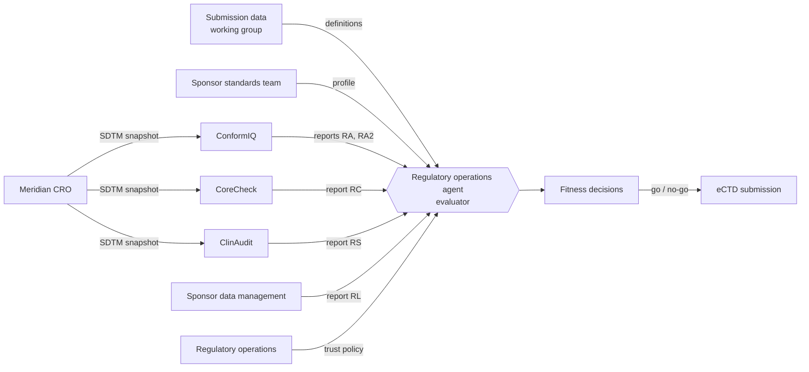
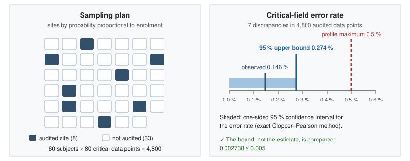
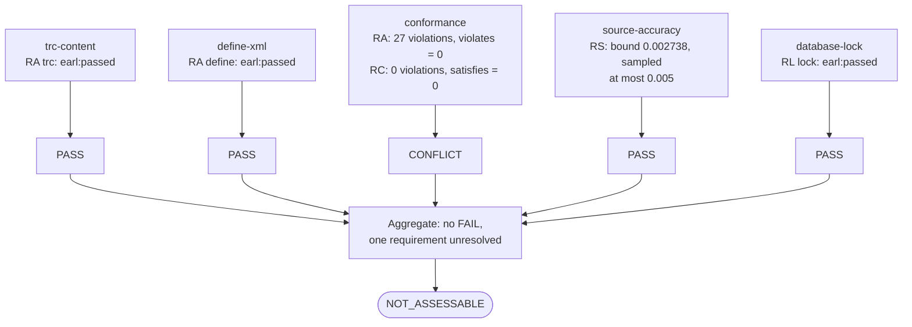
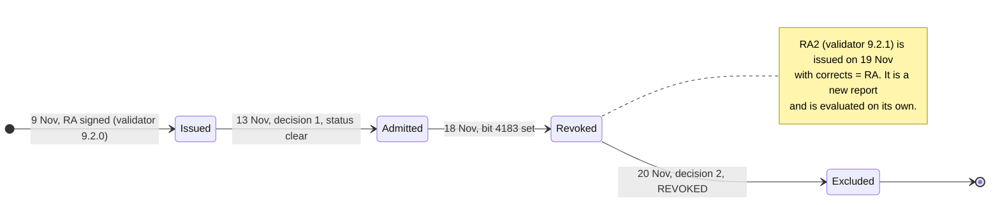

# Checking clinical trial data before an FDA submission

**An end-to-end OFF example · Informative guide to [OFF 0.3 draft](../open-fitness-framework-spec.md)**

> [!NOTE]
> This guide is informative. It explains the specification by example and does not add requirements. The setting follows real practice for submitting study data to the US Food and Drug Administration (FDA): CDISC SDTM datasets with a Define-XML file, checked against the FDA's Technical Rejection Criteria, CDISC conformance rules and the FDA Business Rules. The regulatory facts are cited from the documents listed in [Sources](#sources). All organisations, people, URLs, identifiers, digests, keys and numbers are invented for illustration, and no real report or tool behaviour is claimed. An OFF decision does not mean that the FDA will accept a submission ([Section 1](../open-fitness-framework-spec.md#1-scope-and-draft-status)).

Two earlier guides follow the same outline for geospatial data: [Selecting orthoimagery for tree-vitality training data](tree-vitality-orthoimagery.md) and [Checking INSPIRE conformity of a road network](inspire-road-network.md). This guide uses structured data and shows the parts of the specification they leave out: conflicting evidence, revocation, sampled coverage and evidence that must be retrievable.

## Contents

- [The story in one minute](#the-story-in-one-minute)
- [1 The setting and the cast](#1-the-setting-and-the-cast)
- [2 Step 1: The working group publishes assertion definitions](#2-step-1-the-working-group-publishes-assertion-definitions)
- [3 Step 2: The sponsor publishes a fitness profile](#3-step-2-the-sponsor-publishes-a-fitness-profile)
- [4 Step 3: Regulatory operations sets its trust policy](#4-step-3-regulatory-operations-sets-its-trust-policy)
- [5 Step 4: Database lock and the SDTM snapshot](#5-step-4-database-lock-and-the-sdtm-snapshot)
- [6 Step 5: Four reports](#6-step-5-four-reports)
- [7 Step 6: The first evaluation](#7-step-6-the-first-evaluation)
- [8 Step 7: Tracing the conflict to a validator bug](#8-step-7-tracing-the-conflict-to-a-validator-bug)
- [9 Step 8: Re-evaluation](#9-step-8-re-evaluation)
- [10 Step 9: Submission, and what happens next](#10-step-9-submission-and-what-happens-next)
- [11 What this example shows](#11-what-this-example-shows)
- [Sources](#sources)

## The story in one minute

A pharmaceutical sponsor has finished a Phase 3 study and is preparing a New Drug Application (NDA). Its contract research organisation (CRO) delivers the study data as SDTM datasets with a Define-XML file. Before the regulatory operations team compiles the electronic submission, its agent checks the data against the sponsor's fitness profile. The profile requires:

- the dataset content checked by the FDA's Technical Rejection Criteria: a trial summary with the study start date, a demographics dataset and a Define-XML file;
- a Define-XML file that is valid against the Define-XML 2.1 schema;
- no error-level violations of the CDISC conformance rules and the FDA Business Rules;
- a low rate of transcription errors against source documents, estimated from a sample of sites;
- a data manager's attestation that the database was locked properly.

Two validators check the conformance rules. One reports 27 errors, the other none. Both are trusted, so the evaluator does not pick a winner: the requirement is in **CONFLICT** and the decision is **NOT_ASSESSABLE**. The validator reports point to the cause. The first validator wrongly rejects partial dates such as `2025-03`, which SDTM allows. Its vendor **revokes** the report and issues a corrected one. The data itself never changes. The re-evaluation is **FIT**.

```mermaid
sequenceDiagram
    autonumber
    participant WG as Submission data<br/>working group
    participant SP as Sponsor<br/>(standards, data management)
    participant CRO as CRO
    participant A as ConformIQ<br/>validator
    participant C as CoreCheck<br/>validator
    participant AU as ClinAudit<br/>auditor
    participant RO as Regulatory operations agent<br/>(evaluator)

    WG->>WG: Publish five definitions
    SP->>SP: Publish profile; lock database, sign attestation RL
    RO->>RO: Set trust policy
    CRO->>CRO: Publish SDTM snapshot
    A->>A: Validate, sign report RA (27 errors)
    C->>C: Validate, sign report RC (0 errors)
    AU->>AU: Audit sample of sites, sign report RS
    RO->>RO: Evaluate with RA, RC, RS, RL → NOT_ASSESSABLE (conflict)
    RO-->>CRO: Decision with conflicting traces
    CRO->>A: Report: partial dates flagged as errors
    A->>A: Confirm bug, revoke RA, sign corrected report RA2
    RO->>RO: Evaluate with RA, RC, RS, RL, RA2 → FIT
    RO->>RO: Compile eCTD submission
```

## 1 The setting and the cast

The study is AUR-301, a randomised, double-blind Phase 3 trial with 612 subjects at 41 sites. The first subject gave informed consent on 9 June 2025, which is the study start date in the SDTM sense. Because the study started after 15 March 2025, the FDA Data Standards Catalog requires SDTMIG 3.4 for an NDA. Define-XML 2.1 is required for studies that started after 15 March 2022.

The CRO collected the data in an electronic data capture (EDC) system and converts it to SDTM: 31 datasets in SAS transport (XPT) format, plus `define.xml`. Conversion errors, wrong controlled terms and missing trial-design records are common and can delay a submission. If the FDA's automated checks find a missing trial summary dataset, for example, the submission is rejected before anybody reviews it ([Section 10](#10-step-9-submission-and-what-happens-next)).

| Actor | Fictional organisation | OFF role(s) | What it produces |
| --- | --- | --- | --- |
| Definition publisher | Submission data working group, a cross-industry group (`subdata-wg.example`) | Definition publisher | Five assertion definitions |
| Sponsor, standards team | Aurelia Pharma (`aurelia-pharma.example`) | Profile publisher | One fitness profile |
| Sponsor, data management | Aurelia Pharma clinical data management | Assessor, report issuer | Database-lock attestation, report RL |
| Data provider | Meridian CRO (`meridian-cro.example`) | Asset publisher | The SDTM snapshot |
| Commercial validator | ConformIQ (`conformiq.example`), standing for commercial SDTM validators | Assessor, report issuer | Reports RA and RA2 |
| Open-source validation service | CoreCheck (`corecheck.example`), which runs the open-source CDISC CORE engine | Assessor, report issuer | Report RC |
| Independent auditor | ClinAudit (`clinaudit.example`) | Assessor, report issuer | Sampled source-data audit, report RS |
| Consumer | Aurelia Pharma regulatory operations | Trust policy owner; runs the agent, which acts as evaluator | Trust policy, evaluation requests, decisions |



## 2 Step 1: The working group publishes assertion definitions

The FDA's requirements are written for people. The working group turns the checks that matter for submission readiness into five `AssertionDefinition` documents ([Section 7.1](../open-fitness-framework-spec.md#71-definition-contract)), so that different validators can report results that an evaluator can compare.

| Short name | Kind | Value | What it means |
| --- | --- | --- | --- |
| `fda-trc-dataset-content/1.0` | test | passed or failed | The dataset content checked by the given Technical Rejection Criteria rules is present. |
| `define-xml-validity/1.0` | test | passed or failed | `define.xml` is valid against a pinned Define-XML schema bundle. |
| `conformance-rule-violations/1.0` | measurement | integer, count | Number of violations of pinned rule sets at or above a given severity. |
| `source-data-error-rate/1.0` | measurement | decimal, unitless, 0–1 | Upper confidence bound of the share of critical data points that differ from the source documents. |
| `database-lock-attestation/1.0` | test | passed or failed | A responsible data manager attests that the database was locked properly and the snapshot derives from it. |

### Technical Rejection Criteria as a test

The Technical Rejection Criteria are eCTD validation rules that the FDA applies automatically when a submission arrives. A high-severity error means that the submission is considered not received. Three of the rules concern study data:

- **Rule 1734** requires a trial summary dataset, `ts.xpt`, with the study start date.
- **Rule 1735** requires correct file tags in the eCTD study tagging file.
- **Rule 1736** requires a demographics dataset (`dm.xpt`) and `define.xml` for SDTM data.

Rule 1735, and rule 1738, which compares study identifiers between the study tagging file and `ts.xpt`, concern the eCTD backbone. That backbone is assembled later and is not part of the SDTM snapshot. The definition therefore takes the rules to check as a parameter, and the profile asks only for 1734 and 1736. For rule 1734 the definition states precisely what "with the study start date" means: a TS record with `TSPARMCD` = `SSTDTC` whose `TSVAL` is an ISO 8601 date with at least year, month and day. The `criteria` parameter pins the version of the FDA's validation criteria that the rules come from.

### Conformance rules as a count

`conformance-rule-violations/1.0` counts violations rather than returning pass or fail, as the topology checks in the [road network guide](inspire-road-network.md#topology-as-error-counts) do. Its parameters pin the rule sets, the controlled terminology release and the minimum severity counted. The definition says what the count means independently of any engine. A violation is one record, or one dataset for dataset-level rules, that fails one rule of the pinned rule sets. Two engines that implement the same rules correctly therefore report the same number.

One indeterminate case matters for this guide: if an engine cannot execute every rule of the pinned rule sets, the measurement is `inconclusive` and has no value. An engine that silently skips the rules it does not implement would otherwise report a count that looks better than it is.

### The source-data error rate in full

Accuracy against source documents cannot be checked by software alone. An auditor has to compare SDTM values with the documents at the sites, such as medical records and lab reports, and auditing every data point of 612 subjects is impractical. ICH E6(R3) explicitly allows checking data against source "on the basis of using samples" (Annex 1, 3.11.4.5.4). The definition therefore says how a sampled audit turns into one number, and what that number is when the audit is complete:

```json
{
  "specVersion": "0.3-draft",
  "type": "AssertionDefinition",
  "id": "https://defs.subdata-wg.example/source-data-error-rate/1.0",
  "version": "1.0.0",
  "kind": "measurement",
  "name": "Error rate of critical data points against source documents",
  "assessedProperty": "How often the values of critical data points in a tabulation dataset differ from the source documents they were transcribed from.",
  "parameterSchema": {
    "type": "object",
    "required": ["criticalFields", "confidenceLevel"],
    "additionalProperties": false,
    "properties": {
      "criticalFields": {
        "type": "object",
        "required": ["id", "digest"],
        "properties": { "id": { "type": "string" }, "digest": { "type": "object" } }
      },
      "confidenceLevel": { "type": "string", "pattern": "^0\\.[0-9]+$" }
    }
  },
  "interpretation": "The population is every critical data point, as listed in the pinned criticalFields document, of every subject in the snapshot. A data point is discrepant if its value differs from the source document after the normalisations listed in criticalFields. With complete coverage, the value is the number of discrepant data points divided by the population size. With sampled coverage, the audited data points are selected according to the pinned sampling plan, and the value is the one-sided upper confidence bound at confidenceLevel for the proportion of discrepant data points, computed with the exact Clopper-Pearson method and treating the audited data points as a simple random sample of the population. In both cases the value is rounded upward to six decimal places.",
  "indeterminateCases": [
    "No data point was audited: inconclusive, no value.",
    "Source documents are unavailable for more than 5 % of the selected data points: inconclusive, no value."
  ],
  "valueType": "decimal",
  "unit": "http://qudt.org/vocab/unit/UNITLESS",
  "range": { "minimum": "0", "maximum": "1" },
  "requiredDetails": {
    "dataPointsAudited": "Number of data points compared with source, as an integer string.",
    "discrepancies": "Number of discrepant data points found, as an integer string.",
    "observedRate": "discrepancies divided by dataPointsAudited, rounded upward to six decimal places, as a decimal string.",
    "sitesAudited": "Number of sites whose documents were consulted, as an integer string.",
    "subjectsAudited": "Number of subjects whose data points were audited, as an integer string."
  },
  "dimension": "https://defs.subdata-wg.example/dimensions/accuracy"
}
```

The definition follows the accuracy pattern of [Section 7.4](../open-fitness-framework-spec.md#74-accuracy-and-precision-pattern). It names the quantity, the reference (the source documents), the statistic and the assessment population. Three choices are worth noting:

- **The value is the bound, not the estimate.** A profile that asks for an upper bound cannot be satisfied by a point estimate, so the definition makes the bound the value and puts the observed rate in `details`. An evaluator compares only the value.
- **Rounding upward is conservative.** The bound is compared against a maximum, so rounding it up can only make a pass harder.
- **The independence assumption is stated.** Data points from the same subject or site are not truly independent, so the Clopper–Pearson bound is somewhat optimistic for a clustered sample. A stricter definition could prescribe a design-based bound. Stating the assumption lets a profile publisher decide whether the definition is good enough for its purpose.

### Database lock as an attestation

Locking the database is a documented step in clinical data management. Once all queries are resolved and the data are reviewed, the responsible people approve the lock and sign a closure checklist. `database-lock-attestation/1.0` captures this as a test with empty parameters. It passes when a named data manager attests to two things: the database was locked following a documented approval process with a signed closure checklist, and the SDTM snapshot was derived from the locked database without later data changes. If the data manager cannot confirm the derivation, for example because it was outsourced and not reviewed, the outcome is `earl:cantTell`.

This follows the attestation pattern of [Section 7.5](../open-fitness-framework-spec.md#75-successful-use-and-attestation-pattern). An attestation satisfies only a requirement that asks for this attestation. It can never stand in for validation or for the source-data audit.

## 3 Step 2: The sponsor publishes a fitness profile

The sponsor's standards team writes one profile for all NDA submissions of studies that started after 15 March 2025:

| Requirement | Definition | Parameters | Condition |
| --- | --- | --- | --- |
| `trc-content` | fda-trc-dataset-content | eCTD validation criteria v4.7, rules 1734 and 1736, SDTM | passed |
| `define-xml` | define-xml-validity | Define-XML 2.1 schema bundle | passed |
| `conformance` | conformance-rule-violations | CDISC SDTMIG 3.4 rules + FDA Business Rules v1.5, CT release, severity error | = 0 |
| `source-accuracy` | source-data-error-rate | critical-field list v3, confidence 0.95 | ≤ 0.005 |
| `database-lock` | database-lock-attestation | none | passed |

The `source-accuracy` requirement allows sampled coverage, which needs extension [E1](../open-fitness-framework-spec.md#451-extension-e1-selection-scopes-and-sampled-coverage). The profile therefore declares E1:

```json
{
  "specVersion": "0.3-draft",
  "type": "FitnessProfile",
  "id": "https://aurelia-pharma.example/profiles/fda-sdtm-submission-readiness",
  "version": "1.0.0",
  "name": "SDTM submission readiness for FDA NDAs, studies starting after 15 March 2025",
  "purpose": {
    "id": "https://aurelia-pharma.example/purposes/fda-nda-sdtm-submission",
    "description": "Submit SDTM tabulation data to the FDA as part of an NDA without technical rejection and with data that are conformant, accurate against source, and derived from a properly locked database. SDTMIG 3.4 and Define-XML 2.1. Not a statement that the FDA will accept the submission."
  },
  "requiredExtensions": ["https://www.open-fitness-framework.org/spec/0.3/extensions/E1"],
  "requirements": [
    {
      "id": "trc-content",
      "description": "Trial summary with study start date, demographics and define.xml are present (TRC rules 1734 and 1736).",
      "statement": {
        "definition": {
          "id": "https://defs.subdata-wg.example/fda-trc-dataset-content/1.0",
          "digest": { "algorithm": "sha-256", "value": "3160b1184b875132ad53b052936aab5c31393bcd6e2b68ea62b425974cc3546f" }
        },
        "parameters": {
          "criteria": {
            "id": "https://www.fda.gov/media/87056/download",
            "digest": { "algorithm": "sha-256", "value": "b6b92b06a03c1e8d4aef61fa1cfd0d89142429c17825ee889603b7305553cefa" }
          },
          "rules": ["1734", "1736"],
          "standard": "SDTM"
        }
      },
      "condition": { "operator": "eq", "expected": { "type": "boolean", "value": true } }
    },
    {
      "id": "define-xml",
      "description": "define.xml is valid against the Define-XML 2.1 schema.",
      "statement": {
        "definition": {
          "id": "https://defs.subdata-wg.example/define-xml-validity/1.0",
          "digest": { "algorithm": "sha-256", "value": "520d93f515318c2cac24c0f45abb2c58586fc443bc9d846175339c8a8b805008" }
        },
        "parameters": {
          "schemaBundle": {
            "id": "https://subdata-wg.example/bundles/define-xml-2.1-schemas.zip",
            "digest": { "algorithm": "sha-256", "value": "a64ad23a42c6fbf46370831f0bd7fa1a209ab51d9108aa9844a55f63907d6f96" }
          }
        }
      },
      "condition": { "operator": "eq", "expected": { "type": "boolean", "value": true } }
    },
    {
      "id": "conformance",
      "description": "No error-level violations of the CDISC SDTMIG 3.4 conformance rules and the FDA Business Rules v1.5.",
      "statement": {
        "definition": {
          "id": "https://defs.subdata-wg.example/conformance-rule-violations/1.0",
          "digest": { "algorithm": "sha-256", "value": "311291e7e84c68f5b29339e499ea3af8aeb77baf97a019ae156553a2f938c9d7" }
        },
        "parameters": {
          "ruleSets": [
            {
              "id": "https://subdata-wg.example/rulesets/cdisc-sdtmig-3.4-conformance-2026-11.json",
              "digest": { "algorithm": "sha-256", "value": "9518e4cdb1c45c8378cef3f4ae2e879a452ed0cbf2061ec8b97ad3bae83ad4ec" }
            },
            {
              "id": "https://subdata-wg.example/rulesets/fda-business-rules-1.5-sdtm-2026-11.json",
              "digest": { "algorithm": "sha-256", "value": "cc4d878dd469d2f400f94e530ee0b5b01b45f85d30e8fdb2b0482d4748e480df" }
            }
          ],
          "terminology": {
            "id": "https://subdata-wg.example/terminology/cdisc-ct-sdtm-2026-q3.json",
            "digest": { "algorithm": "sha-256", "value": "bc8ff968d0f57a15afbf965b9f4540e75e63a72b4e97ee2668467dca36dcc49c" }
          },
          "minimumSeverity": "error"
        }
      },
      "condition": {
        "operator": "eq",
        "expected": { "type": "integer", "value": "0", "unit": "http://qudt.org/vocab/unit/NUM" }
      }
    },
    {
      "id": "source-accuracy",
      "description": "The 95 % upper confidence bound of the critical-field error rate against source is at most 0.5 %.",
      "statement": {
        "definition": {
          "id": "https://defs.subdata-wg.example/source-data-error-rate/1.0",
          "digest": { "algorithm": "sha-256", "value": "44ec192ebd7e1375e239298776dee843aa3161e811e68e60194eda56952d36e1" }
        },
        "parameters": {
          "criticalFields": {
            "id": "https://aurelia-pharma.example/standards/critical-fields/v3.json",
            "digest": { "algorithm": "sha-256", "value": "71de39fdbce74d9a28590f10cd0f5a307c4697dd104a733d6ce0eebf073874f0" }
          },
          "confidenceLevel": "0.95"
        }
      },
      "condition": {
        "operator": "lte",
        "expected": { "type": "decimal", "value": "0.005", "unit": "http://qudt.org/vocab/unit/UNITLESS" }
      },
      "evidence": { "allowedCoverage": ["complete", "sampled"] }
    },
    {
      "id": "database-lock",
      "description": "Data management attests a documented database lock from which the snapshot derives.",
      "statement": {
        "definition": {
          "id": "https://defs.subdata-wg.example/database-lock-attestation/1.0",
          "digest": { "algorithm": "sha-256", "value": "459fdcbd4d0feac1550c80ab87125670baca6676063923891feac51879cd9d2a" }
        },
        "parameters": {}
      },
      "condition": { "operator": "eq", "expected": { "type": "boolean", "value": true } }
    }
  ]
}
```

Three choices in this profile are worth noting:

- **Zero errors is the sponsor's own policy.** The FDA's Study Data Technical Conformance Guide asks sponsors to correct validation issues or explain meaningful ones in the clinical Study Data Reviewer's Guide (cSDRG). Aurelia Pharma requires zero errors before submission so that nothing needs explaining. A profile that allowed explained issues would need a definition that takes the pinned cSDRG as a parameter and counts only unexplained violations. Deciding whether an explanation covers a violation is hard to define, so this guide leaves it out.
- **The 0.5 % threshold is illustrative.** No regulation sets an error rate. The sponsor chose a value that its quality function considers acceptable for critical fields.
- **Only `source-accuracy` allows sampled coverage.** The other requirements keep the default `["complete"]`. A validator that checked only a sample of records would not be admitted for them ([Section 5.3](../open-fitness-framework-spec.md#53-evidence-constraints)).

## 4 Step 3: Regulatory operations sets its trust policy

Regulatory operations decides whose evidence it accepts and under which conditions ([Section 8.2](../open-fitness-framework-spec.md#82-local-trust-policy)):

| Issuer | Trusted for | Reasoning |
| --- | --- | --- |
| ConformIQ | TRC content, Define-XML validity, conformance rules | Established commercial validator; implements the FDA rules. |
| CoreCheck | conformance rules | Runs the open-source CDISC CORE engine, whose first production release covers the SDTMIG conformance rules and the FDA Business Rules for SDTM. |
| ClinAudit | source-data error rate | Independent auditor with documented sampling procedures. |
| Sponsor data management | database-lock attestation | The only party that can attest to its own lock process. It is not trusted for any check of the data. |

The CRO is not a trusted issuer. It validates its own deliveries, but the sponsor wants independent evidence. The policy also uses three extensions:

- **[E1](../open-fitness-framework-spec.md#451-extension-e1-selection-scopes-and-sampled-coverage):** `allowedCoverage` includes `sampled`, so that ClinAudit's audit can be admitted. Coverage is admitted only if both the profile and the policy allow it.
- **[E2](../open-fitness-framework-spec.md#531-extension-e2-retrievable-evidence):** `evidenceAccess` is `retrievable`. Every admitted record must reference evidence that the evaluator retrieves and digest-verifies. Regulatory operations wants to be able to see what a validator found, not just the count.
- **[E4](../open-fitness-framework-spec.md#83-extension-e4-credential-status):** every report must carry a credential status (`allowNoCredentialStatus` is `false`), and status lists may be at most one day old. All four issuers republish their lists daily. A validator that discovers a bug must be able to withdraw its reports before they reach a submission.

```json
{
  "specVersion": "0.3-draft",
  "type": "TrustPolicy",
  "id": "https://aurelia-pharma.example/policies/regulatory-submission",
  "version": "4",
  "requiredExtensions": [
    "https://www.open-fitness-framework.org/spec/0.3/extensions/E1",
    "https://www.open-fitness-framework.org/spec/0.3/extensions/E2",
    "https://www.open-fitness-framework.org/spec/0.3/extensions/E4"
  ],
  "trustedIssuers": [
    {
      "issuer": "https://conformiq.example/issuer",
      "keys": [
        {
          "id": "https://conformiq.example/issuer#2026",
          "algorithm": "ES256",
          "key": { "kty": "EC", "crv": "P-256", "x": "Lg_7JW3CACek0eRrlBRkFT7wEj4detbncRvBLCCCIW0", "y": "8b0HXVBjqEklbxe7YbAivLy3FY2EevV888iWKlb8opM" }
        }
      ],
      "allowedDefinitions": [
        { "id": "https://defs.subdata-wg.example/fda-trc-dataset-content/1.0", "digest": { "algorithm": "sha-256", "value": "3160b1184b875132ad53b052936aab5c31393bcd6e2b68ea62b425974cc3546f" } },
        { "id": "https://defs.subdata-wg.example/define-xml-validity/1.0", "digest": { "algorithm": "sha-256", "value": "520d93f515318c2cac24c0f45abb2c58586fc443bc9d846175339c8a8b805008" } },
        { "id": "https://defs.subdata-wg.example/conformance-rule-violations/1.0", "digest": { "algorithm": "sha-256", "value": "311291e7e84c68f5b29339e499ea3af8aeb77baf97a019ae156553a2f938c9d7" } }
      ]
    },
    {
      "issuer": "https://corecheck.example/issuer",
      "keys": [
        {
          "id": "https://corecheck.example/issuer#svc-1",
          "algorithm": "ES256",
          "key": { "kty": "EC", "crv": "P-256", "x": "IbKsYV46cSoEEaTJyK--HhSkwgAq2VD17BTP0TPi32s", "y": "J66LF_RQN6e048YlEk_mhuiuCamxpQDt8EnyMRPUaR8" }
        }
      ],
      "allowedDefinitions": [
        { "id": "https://defs.subdata-wg.example/conformance-rule-violations/1.0", "digest": { "algorithm": "sha-256", "value": "311291e7e84c68f5b29339e499ea3af8aeb77baf97a019ae156553a2f938c9d7" } }
      ]
    },
    {
      "issuer": "https://clinaudit.example/issuer",
      "keys": [
        {
          "id": "https://clinaudit.example/issuer#audit-2026",
          "algorithm": "ES256",
          "key": { "kty": "EC", "crv": "P-256", "x": "UslRYPNoQGyBhgpb2893FmiRXv6hi6ZMK6-pqBc0ZbA", "y": "hGwjSEZ_HobOugIY4DpyaWJProf5P3hpOfvCx-A2YQM" }
        }
      ],
      "allowedDefinitions": [
        { "id": "https://defs.subdata-wg.example/source-data-error-rate/1.0", "digest": { "algorithm": "sha-256", "value": "44ec192ebd7e1375e239298776dee843aa3161e811e68e60194eda56952d36e1" } }
      ]
    },
    {
      "issuer": "https://aurelia-pharma.example/data-management",
      "keys": [
        {
          "id": "https://aurelia-pharma.example/data-management#dm-1",
          "algorithm": "ES256",
          "key": { "kty": "EC", "crv": "P-256", "x": "ku4z2zzJ8yEqtJJsDiEfvp1W-vlgEkWDo9WCM0CEUak", "y": "JWk0xJheJTJmRvGr76XqYZ7e0E74KuRCU8leWsX9Isk" }
        }
      ],
      "allowedDefinitions": [
        { "id": "https://defs.subdata-wg.example/database-lock-attestation/1.0", "digest": { "algorithm": "sha-256", "value": "459fdcbd4d0feac1550c80ab87125670baca6676063923891feac51879cd9d2a" } }
      ]
    }
  ],
  "maxAssessmentAgeSeconds": 15552000,
  "allowedCoverage": ["complete", "sampled"],
  "evidenceAccess": "retrievable",
  "allowNoCredentialStatus": false,
  "maxStatusAgeSeconds": 86400
}
```

### Retrievable evidence without patient data

Retrievable evidence and patient privacy pull in opposite directions. A validator's full issue list names subjects and records, and audit worksheets contain values copied from medical records. Study subjects are identified only by codes in SDTM, but such data are still personal health data. Access to them is governed by consent forms, data protection law and contracts, and an OFF signature changes none of that ([Section 13](../open-fitness-framework-spec.md#13-privacy-and-implementation-controls)).

The issuers resolve this by referencing only aggregate, de-identified artifacts as evidence:

- the validators publish rule-level results: for each violated rule, the dataset, the variable, the number of violations and a few example values, without subject identifiers;
- the auditor publishes the sampling plan and a summary of discrepancies per critical field and per site, without subject identifiers;
- data management publishes the signed closure checklist.

Each party passes the detailed listings to those who need them through its normal, access-controlled channels. Those listings are not referenced in the reports. E2 establishes that the referenced evidence exists and has not changed; it does not require that every detail behind a record is public ([Section 5.3.1](../open-fitness-framework-spec.md#531-extension-e2-retrievable-evidence)).

## 5 Step 4: Database lock and the SDTM snapshot

On 30 October 2026, after the last queries are resolved, Aurelia Pharma locks the clinical database. The lead data manager, the study biostatistician and the clinical lead approve the lock, and data management signs the closure checklist. The CRO then derives the final SDTM datasets from the locked database and publishes them on 5 November 2026. A manifest lists every XPT file and `define.xml` with their digests, and the snapshot is bound to the manifest's digest ([Section 4.4](../open-fitness-framework-spec.md#44-data-asset-binding)).

| Field | Value |
| --- | --- |
| `assetId` | `https://data.aurelia-pharma.example/studies/AUR-301/sdtm` |
| `representationId` | `https://data.aurelia-pharma.example/studies/AUR-301/sdtm/xpt-define-2.1` |
| `snapshotId` | `https://data.aurelia-pharma.example/studies/AUR-301/sdtm/snapshots/2026-11-05` |
| `digestKind` | `manifest` (31 XPT files and `define.xml`) |
| Content | 612 subjects in DM; among others 9,418 AE, 14,206 CM and 187,330 LB records |

The snapshot contains 27 dates of reduced precision: 19 adverse-event start dates (`AESTDTC`) and 8 concomitant-medication start dates (`CMSTDTC`) are known only to the month, for example `2025-03`. Subjects often cannot remember the exact day on which a symptom began or a medication was started. SDTM records such dates in ISO 8601 with reduced precision instead of inventing a day.

## 6 Step 5: Four reports

### Report RA: ConformIQ

The CRO orders a validation from ConformIQ, which runs its validator version 9.2.0 on the snapshot and checks three of the five requirements. Below is the complete credential. It carries a `credentialStatus` entry, which points to position 4183 of ConformIQ's revocation list for November 2026. The report body therefore declares E4.

```json
{
  "@context": [
    "https://www.w3.org/ns/credentials/v2",
    {
      "OffFitnessReportCredential": "https://www.open-fitness-framework.org/spec/0.3/FitnessReportCredential",
      "OffAssetSnapshot": "https://www.open-fitness-framework.org/spec/0.3/AssetSnapshot",
      "offReport": { "@id": "https://www.open-fitness-framework.org/spec/0.3/report", "@type": "@json" }
    }
  ],
  "id": "https://conformiq.example/reports/2026-11-0917",
  "type": ["VerifiableCredential", "OffFitnessReportCredential"],
  "issuer": "https://conformiq.example/issuer",
  "validFrom": "2026-11-09T14:00:00Z",
  "validUntil": "2027-05-09T14:00:00Z",
  "credentialStatus": {
    "id": "https://conformiq.example/status/2026-11#4183",
    "type": "BitstringStatusListEntry",
    "statusPurpose": "revocation",
    "statusListIndex": "4183",
    "statusListCredential": "https://conformiq.example/status/2026-11"
  },
  "credentialSubject": {
    "id": "https://data.aurelia-pharma.example/studies/AUR-301/sdtm/snapshots/2026-11-05",
    "type": "OffAssetSnapshot",
    "offReport": {
      "specVersion": "0.3-draft",
      "requiredExtensions": ["https://www.open-fitness-framework.org/spec/0.3/extensions/E4"],
      "subject": {
        "assetId": "https://data.aurelia-pharma.example/studies/AUR-301/sdtm",
        "representationId": "https://data.aurelia-pharma.example/studies/AUR-301/sdtm/xpt-define-2.1",
        "snapshotId": "https://data.aurelia-pharma.example/studies/AUR-301/sdtm/snapshots/2026-11-05",
        "digestKind": "manifest",
        "digest": { "algorithm": "sha-256", "value": "02168875c57649862a042a02a1d1671e987e48a17367aabbbd64eaa2e003ee52" }
      },
      "scope": { "kind": "whole" },
      "coverage": { "kind": "complete" },
      "issuedAt": "2026-11-09T14:00:00Z",
      "assessment": {
        "id": "https://conformiq.example/runs/2026-11-0917",
        "operator": "https://conformiq.example/issuer",
        "mode": "earl:automatic",
        "method": {
          "id": "https://conformiq.example/methods/fda-sdtm-submission/9.2",
          "digest": { "algorithm": "sha-256", "value": "399cd917420554debbe78abc68b12e4a2ac958bfba0163f323eef2e1f658d2f2" }
        },
        "endedAt": "2026-11-09T11:42:00Z",
        "tools": [{ "id": "https://conformiq.example/tools/validator", "version": "9.2.0" }]
      },
      "assertions": [
        {
          "id": "trc",
          "kind": "test",
          "definition": {
            "id": "https://defs.subdata-wg.example/fda-trc-dataset-content/1.0",
            "digest": { "algorithm": "sha-256", "value": "3160b1184b875132ad53b052936aab5c31393bcd6e2b68ea62b425974cc3546f" }
          },
          "parameters": {
            "criteria": {
              "id": "https://www.fda.gov/media/87056/download",
              "digest": { "algorithm": "sha-256", "value": "b6b92b06a03c1e8d4aef61fa1cfd0d89142429c17825ee889603b7305553cefa" }
            },
            "rules": ["1734", "1736"],
            "standard": "SDTM"
          },
          "result": { "outcome": "earl:passed" },
          "details": { "studyStartDate": "2025-06-09" },
          "evidence": ["results"],
          "limitations": []
        },
        {
          "id": "define",
          "kind": "test",
          "definition": {
            "id": "https://defs.subdata-wg.example/define-xml-validity/1.0",
            "digest": { "algorithm": "sha-256", "value": "520d93f515318c2cac24c0f45abb2c58586fc443bc9d846175339c8a8b805008" }
          },
          "parameters": {
            "schemaBundle": {
              "id": "https://subdata-wg.example/bundles/define-xml-2.1-schemas.zip",
              "digest": { "algorithm": "sha-256", "value": "a64ad23a42c6fbf46370831f0bd7fa1a209ab51d9108aa9844a55f63907d6f96" }
            }
          },
          "result": { "outcome": "earl:passed" },
          "evidence": ["results"],
          "limitations": []
        },
        {
          "id": "conformance",
          "kind": "measurement",
          "definition": {
            "id": "https://defs.subdata-wg.example/conformance-rule-violations/1.0",
            "digest": { "algorithm": "sha-256", "value": "311291e7e84c68f5b29339e499ea3af8aeb77baf97a019ae156553a2f938c9d7" }
          },
          "parameters": {
            "ruleSets": [
              {
                "id": "https://subdata-wg.example/rulesets/cdisc-sdtmig-3.4-conformance-2026-11.json",
                "digest": { "algorithm": "sha-256", "value": "9518e4cdb1c45c8378cef3f4ae2e879a452ed0cbf2061ec8b97ad3bae83ad4ec" }
              },
              {
                "id": "https://subdata-wg.example/rulesets/fda-business-rules-1.5-sdtm-2026-11.json",
                "digest": { "algorithm": "sha-256", "value": "cc4d878dd469d2f400f94e530ee0b5b01b45f85d30e8fdb2b0482d4748e480df" }
              }
            ],
            "terminology": {
              "id": "https://subdata-wg.example/terminology/cdisc-ct-sdtm-2026-q3.json",
              "digest": { "algorithm": "sha-256", "value": "bc8ff968d0f57a15afbf965b9f4540e75e63a72b4e97ee2668467dca36dcc49c" }
            },
            "minimumSeverity": "error"
          },
          "executionStatus": "completed",
          "value": { "type": "integer", "value": "27", "unit": "http://qudt.org/vocab/unit/NUM" },
          "details": { "rulesEvaluated": "684", "rulesViolated": "1", "violations": "27" },
          "evidence": ["results"],
          "limitations": []
        }
      ],
      "evidence": [
        {
          "id": "results",
          "resource": {
            "id": "https://conformiq.example/runs/2026-11-0917/rule-results.json",
            "digest": { "algorithm": "sha-256", "value": "af8f3a78784497bfea01f399f15684afa6800fb03a51a9f709ffaeda2f33fb94" }
          },
          "href": "https://conformiq.example/runs/2026-11-0917/rule-results.json",
          "mediaType": "application/json",
          "role": "result",
          "description": "Rule-level results: for each violated rule the dataset, variable, count and up to five example values; no subject identifiers."
        }
      ]
    }
  }
}
```

### Report RC: CoreCheck

CoreCheck runs the CDISC CORE engine on the same snapshot, with the same pinned rule sets and terminology. Its report has one record, with the same definition and parameters as RA's `conformance` record, and the value 0:

```json
{
  "id": "conformance",
  "kind": "measurement",
  "definition": {
    "id": "https://defs.subdata-wg.example/conformance-rule-violations/1.0",
    "digest": { "algorithm": "sha-256", "value": "311291e7e84c68f5b29339e499ea3af8aeb77baf97a019ae156553a2f938c9d7" }
  },
  "parameters": {
    "ruleSets": [
      {
        "id": "https://subdata-wg.example/rulesets/cdisc-sdtmig-3.4-conformance-2026-11.json",
        "digest": { "algorithm": "sha-256", "value": "9518e4cdb1c45c8378cef3f4ae2e879a452ed0cbf2061ec8b97ad3bae83ad4ec" }
      },
      {
        "id": "https://subdata-wg.example/rulesets/fda-business-rules-1.5-sdtm-2026-11.json",
        "digest": { "algorithm": "sha-256", "value": "cc4d878dd469d2f400f94e530ee0b5b01b45f85d30e8fdb2b0482d4748e480df" }
      }
    ],
    "terminology": {
      "id": "https://subdata-wg.example/terminology/cdisc-ct-sdtm-2026-q3.json",
      "digest": { "algorithm": "sha-256", "value": "bc8ff968d0f57a15afbf965b9f4540e75e63a72b4e97ee2668467dca36dcc49c" }
    },
    "minimumSeverity": "error"
  },
  "executionStatus": "completed",
  "value": { "type": "integer", "value": "0", "unit": "http://qudt.org/vocab/unit/NUM" },
  "details": { "rulesEvaluated": "684", "rulesViolated": "0", "violations": "0" },
  "evidence": ["results"],
  "limitations": []
}
```

The rest of RC follows the same pattern as RA: report id `https://corecheck.example/reports/aur-301-2026-11-10`, issuer `https://corecheck.example/issuer`, status entry at position 77 of `https://corecheck.example/status/1`, assessment `earl:automatic` ended 2026-11-10T08:15:00Z with tool `https://corecheck.example/tools/cdisc-core-engine`, and one evidence item with rule-level results.

### Report RS: ClinAudit's sampled audit

ClinAudit audits the snapshot against source documents. Its sampling plan selects 8 of the 41 sites with probability proportional to enrolment, then 60 subjects at random within those sites. For each subject it audits the 80 critical data points listed in the sponsor's critical-field list, 4,800 data points in total. Seven are discrepant: four transposed digits in lab values, two wrong dates and one wrong dose unit.



Because only a sample was examined, the report states sampled coverage with the pinned sampling plan and declares E1 ([Section 4.5.1](../open-fitness-framework-spec.md#451-extension-e1-selection-scopes-and-sampled-coverage)). All records of a report share its coverage ([Section 6.2](../open-fitness-framework-spec.md#62-report-body-and-assessment)), so the audit is a report of its own. The report body:

```json
{
  "specVersion": "0.3-draft",
  "requiredExtensions": [
    "https://www.open-fitness-framework.org/spec/0.3/extensions/E1",
    "https://www.open-fitness-framework.org/spec/0.3/extensions/E4"
  ],
  "subject": {
    "assetId": "https://data.aurelia-pharma.example/studies/AUR-301/sdtm",
    "representationId": "https://data.aurelia-pharma.example/studies/AUR-301/sdtm/xpt-define-2.1",
    "snapshotId": "https://data.aurelia-pharma.example/studies/AUR-301/sdtm/snapshots/2026-11-05",
    "digestKind": "manifest",
    "digest": { "algorithm": "sha-256", "value": "02168875c57649862a042a02a1d1671e987e48a17367aabbbd64eaa2e003ee52" }
  },
  "scope": { "kind": "whole" },
  "coverage": {
    "kind": "sampled",
    "samplingPlan": {
      "id": "https://clinaudit.example/plans/aur-301-sdv-2026-11.json",
      "digest": { "algorithm": "sha-256", "value": "1c141791791217004e07543d6ba4600134d146c96f7a5fe7ae43f738b52b59b0" }
    }
  },
  "issuedAt": "2026-11-12T16:00:00Z",
  "assessment": {
    "id": "https://clinaudit.example/audits/aur-301-2026-11",
    "operator": "https://clinaudit.example/issuer",
    "mode": "earl:semiAuto",
    "method": {
      "id": "https://clinaudit.example/methods/source-data-audit/4",
      "digest": { "algorithm": "sha-256", "value": "7f9f485236c20b8e02d11d17ce635d19b50655b460483273058cf00199bdc15e" }
    },
    "startedAt": "2026-11-06T08:00:00Z",
    "endedAt": "2026-11-11T17:30:00Z",
    "tools": [{ "id": "https://clinaudit.example/tools/audit-workbench", "version": "5.1" }]
  },
  "assertions": [
    {
      "id": "errorRate",
      "kind": "measurement",
      "definition": {
        "id": "https://defs.subdata-wg.example/source-data-error-rate/1.0",
        "digest": { "algorithm": "sha-256", "value": "44ec192ebd7e1375e239298776dee843aa3161e811e68e60194eda56952d36e1" }
      },
      "parameters": {
        "criticalFields": {
          "id": "https://aurelia-pharma.example/standards/critical-fields/v3.json",
          "digest": { "algorithm": "sha-256", "value": "71de39fdbce74d9a28590f10cd0f5a307c4697dd104a733d6ce0eebf073874f0" }
        },
        "confidenceLevel": "0.95"
      },
      "executionStatus": "completed",
      "value": { "type": "decimal", "value": "0.002738", "unit": "http://qudt.org/vocab/unit/UNITLESS" },
      "details": {
        "dataPointsAudited": "4800",
        "discrepancies": "7",
        "observedRate": "0.001459",
        "sitesAudited": "8",
        "subjectsAudited": "60"
      },
      "evidence": ["plan", "summary"],
      "limitations": []
    }
  ],
  "evidence": [
    {
      "id": "plan",
      "resource": {
        "id": "https://clinaudit.example/plans/aur-301-sdv-2026-11.json",
        "digest": { "algorithm": "sha-256", "value": "1c141791791217004e07543d6ba4600134d146c96f7a5fe7ae43f738b52b59b0" }
      },
      "href": "https://clinaudit.example/plans/aur-301-sdv-2026-11.json",
      "mediaType": "application/json",
      "role": "method",
      "description": "Sampling plan: sites by probability proportional to enrolment, subjects at random within sites, random seed."
    },
    {
      "id": "summary",
      "resource": {
        "id": "https://clinaudit.example/audits/aur-301-2026-11/summary.json",
        "digest": { "algorithm": "sha-256", "value": "29949ed4f6ac1f7d70e52c3fe3282f9feaf5aa604dd6f05d7255bd3144808cec" }
      },
      "href": "https://clinaudit.example/audits/aur-301-2026-11/summary.json",
      "mediaType": "application/json",
      "role": "result",
      "description": "Discrepancies per critical field and per site; no subject identifiers."
    }
  ]
}
```

The value 0.002738 is the one-sided 95 % Clopper–Pearson upper bound for 7 discrepancies in 4,800 data points (0.0027374…), rounded upward to six decimal places. The sampling plan is both the coverage's `samplingPlan` and an evidence item. As coverage, it says how the sample was drawn. As evidence, it is retrieved and digest-verified under E2 like any other item.

### Report RL: the database-lock attestation

Aurelia Pharma's lead data manager signs the attestation through data management's issuer key. The assessment is `earl:manual` with an empty `tools` array, and the operator is the data manager in person:

```json
{
  "id": "lock",
  "kind": "test",
  "definition": {
    "id": "https://defs.subdata-wg.example/database-lock-attestation/1.0",
    "digest": { "algorithm": "sha-256", "value": "459fdcbd4d0feac1550c80ab87125670baca6676063923891feac51879cd9d2a" }
  },
  "parameters": {},
  "assertedBy": "https://aurelia-pharma.example/people/m-okafor",
  "result": { "outcome": "earl:passed" },
  "details": { "lockedAt": "2026-10-30T15:20:00Z" },
  "evidence": ["checklist"],
  "limitations": []
}
```

The rest of RL: report id `https://aurelia-pharma.example/data-management/reports/aur-301-lock`, issued 2026-11-06T10:00:00Z, status entry at position 12 of `https://aurelia-pharma.example/data-management/status/1`, assessment ended 2026-11-06T09:30:00Z after the data manager compared the snapshot manifest with the locked database export, and one evidence item, the signed closure checklist as PDF.

## 7 Step 6: The first evaluation

On 13 November, the regulatory operations agent has four reports for the snapshot and pins them in an evaluation request ([Section 9](../open-fitness-framework-spec.md#9-evaluation-requests)). The request declares the union of the profile's and policy's extensions:

```json
{
  "specVersion": "0.3-draft",
  "type": "EvaluationRequest",
  "id": "https://aurelia-pharma.example/regops/evaluations/aur-301-2026-11-13",
  "subject": {
    "assetId": "https://data.aurelia-pharma.example/studies/AUR-301/sdtm",
    "representationId": "https://data.aurelia-pharma.example/studies/AUR-301/sdtm/xpt-define-2.1",
    "snapshotId": "https://data.aurelia-pharma.example/studies/AUR-301/sdtm/snapshots/2026-11-05",
    "digestKind": "manifest",
    "digest": { "algorithm": "sha-256", "value": "02168875c57649862a042a02a1d1671e987e48a17367aabbbd64eaa2e003ee52" }
  },
  "scope": { "kind": "whole" },
  "purpose": "https://aurelia-pharma.example/purposes/fda-nda-sdtm-submission",
  "profile": {
    "id": "https://aurelia-pharma.example/profiles/fda-sdtm-submission-readiness/1.0.0.json",
    "digest": { "algorithm": "sha-256", "value": "4c921c4ecf505b71b7779652ce23208a342498a850fb047f6e974fb6f0b2f765" }
  },
  "trustPolicy": {
    "id": "https://aurelia-pharma.example/policies/regulatory-submission/4.json",
    "digest": { "algorithm": "sha-256", "value": "eb0f1b6f0da87590179862ccb339ad397de228cff1ed452acc6cfca9efa9a8ae" }
  },
  "evaluatedAt": "2026-11-13T09:00:00Z",
  "requiredExtensions": [
    "https://www.open-fitness-framework.org/spec/0.3/extensions/E1",
    "https://www.open-fitness-framework.org/spec/0.3/extensions/E2",
    "https://www.open-fitness-framework.org/spec/0.3/extensions/E4"
  ],
  "reportResources": [
    { "id": "https://conformiq.example/reports/2026-11-0917.jwt", "digest": { "algorithm": "sha-256", "value": "7af2aa643227577082caf3dc410756b3fa0d816e47ff155a64dfc31b87d7390d" } },
    { "id": "https://corecheck.example/reports/aur-301-2026-11-10.jwt", "digest": { "algorithm": "sha-256", "value": "884b5772dee9ce392339b1c8e1430bd7aa3c37958ca1ca4cb5a0eb0b6c1c8903" } },
    { "id": "https://clinaudit.example/reports/aur-301-2026-11.jwt", "digest": { "algorithm": "sha-256", "value": "fe470f012e21785a5cc4b968a55c1ae474ab4e1ed86636de9314080138ec0ef8" } },
    { "id": "https://aurelia-pharma.example/data-management/reports/aur-301-lock.jwt", "digest": { "algorithm": "sha-256", "value": "54dc34cc58524c4915201900c557b9dd727dad557a97c2d1acc4d2bf4a742501" } }
  ]
}
```

### What the evaluator does

Compared with the earlier guides, the evaluator has two extra tasks before it can compare values:

1. **Status checks (E4).** For each of the four reports, it fetches the issuer's status list, authenticates it, checks that it was published and retrieved within the last day, and reads the bit at the report's index. All four bits are 0: no report is revoked.
2. **Evidence retrieval (E2).** For each candidate record, it retrieves every referenced evidence item and verifies its digest. All five items are available and intact.

Then it matches records to requirements ([Section 10.3](../open-fitness-framework-spec.md#103-select-and-admit-records)). RS has sampled coverage, which both the `source-accuracy` requirement and the policy allow, so its record is admitted.



The conflict is the point of this step:

- **Both records are admitted.** Both issuers are trusted for the definition, both reports authenticate and are not revoked, and both records match the requirement exactly. One satisfies `= 0` and the other violates it, so the requirement outcome is CONFLICT ([Section 10.4](../open-fitness-framework-spec.md#104-determine-requirement-outcomes)).
- **The evaluator does not pick a winner.** There is no newest-wins rule, no issuer ranking and no majority vote. Choosing the favourable report would be exactly the selective admission that [Section 5.3](../open-fitness-framework-spec.md#53-evidence-constraints) forbids.
- **CONFLICT is not FAIL.** No admitted evidence establishes that the data violate the requirement without contradiction. The decision is NOT_ASSESSABLE, not NOT_FIT.

### Decision 1: NOT_ASSESSABLE

The decision records the four status checks in `statusChecks` ([Section 11](../open-fitness-framework-spec.md#11-fitness-decisions)). Each entry pins the exact status-list bytes the evaluator read and when it retrieved them. If one of these reports were revoked later, a reader could still see that it was not revoked at the time of this decision.

```json
{
  "specVersion": "0.3-draft",
  "type": "FitnessDecision",
  "id": "https://aurelia-pharma.example/regops/decisions/aur-301-2026-11-13",
  "request": {
    "id": "https://aurelia-pharma.example/regops/evaluations/aur-301-2026-11-13.json",
    "digest": { "algorithm": "sha-256", "value": "1f5e8f3a3d2b48c0ac53013449faceb57c708fc06f24f18881c1e17bd727e802" }
  },
  "evaluator": { "id": "https://aurelia-pharma.example/regops/agent/off-evaluator", "version": "2.1.0" },
  "decidedAt": "2026-11-13T09:00:21Z",
  "evaluationStatus": "completed",
  "result": "NOT_ASSESSABLE",
  "requirementResults": [
    {
      "id": "trc-content",
      "outcome": "PASS",
      "reasons": ["PREDICATE_SATISFIED"],
      "acceptedTrace": [{ "report": "https://conformiq.example/reports/2026-11-0917", "assertion": "trc", "predicate": "PASS" }],
      "excludedTrace": []
    },
    {
      "id": "define-xml",
      "outcome": "PASS",
      "reasons": ["PREDICATE_SATISFIED"],
      "acceptedTrace": [{ "report": "https://conformiq.example/reports/2026-11-0917", "assertion": "define", "predicate": "PASS" }],
      "excludedTrace": []
    },
    {
      "id": "conformance",
      "outcome": "CONFLICT",
      "reasons": ["CONFLICTING_EVIDENCE"],
      "acceptedTrace": [
        { "report": "https://conformiq.example/reports/2026-11-0917", "assertion": "conformance", "predicate": "FAIL" },
        { "report": "https://corecheck.example/reports/aur-301-2026-11-10", "assertion": "conformance", "predicate": "PASS" }
      ],
      "excludedTrace": []
    },
    {
      "id": "source-accuracy",
      "outcome": "PASS",
      "reasons": ["PREDICATE_SATISFIED"],
      "acceptedTrace": [{ "report": "https://clinaudit.example/reports/aur-301-2026-11", "assertion": "errorRate", "predicate": "PASS" }],
      "excludedTrace": []
    },
    {
      "id": "database-lock",
      "outcome": "PASS",
      "reasons": ["PREDICATE_SATISFIED"],
      "acceptedTrace": [{ "report": "https://aurelia-pharma.example/data-management/reports/aur-301-lock", "assertion": "lock", "predicate": "PASS" }],
      "excludedTrace": []
    }
  ],
  "errors": [],
  "limitations": [
    "Submitted-only evidence set; no discovery was performed by the evaluator.",
    "source-accuracy rests on a sampled audit; the evaluator does not reassess the sampling plan or the estimate."
  ],
  "statusChecks": [
    {
      "report": "https://conformiq.example/reports/2026-11-0917",
      "status": "clear",
      "observedAt": "2026-11-13T08:59:40Z",
      "statusList": { "id": "https://conformiq.example/status/2026-11", "digest": { "algorithm": "sha-256", "value": "379d6db4190c550a04efe33b86f75f75638047572704855e6282e347d48158d2" } }
    },
    {
      "report": "https://corecheck.example/reports/aur-301-2026-11-10",
      "status": "clear",
      "observedAt": "2026-11-13T08:59:41Z",
      "statusList": { "id": "https://corecheck.example/status/1", "digest": { "algorithm": "sha-256", "value": "6c2e67057f4cb1035ef395751396deb5d0efa1438c554a75d6028c965525930a" } }
    },
    {
      "report": "https://clinaudit.example/reports/aur-301-2026-11",
      "status": "clear",
      "observedAt": "2026-11-13T08:59:41Z",
      "statusList": { "id": "https://clinaudit.example/status/2026", "digest": { "algorithm": "sha-256", "value": "04fcc86f70d68366220aeea4e878c41953e57c6ed4a831454b7400f516eda0b3" } }
    },
    {
      "report": "https://aurelia-pharma.example/data-management/reports/aur-301-lock",
      "status": "clear",
      "observedAt": "2026-11-13T08:59:42Z",
      "statusList": { "id": "https://aurelia-pharma.example/data-management/status/1", "digest": { "algorithm": "sha-256", "value": "efa4b82283210ac96cde5fb03d1679b6f1f1634f97561f6f9323a9850291ed05" } }
    }
  ]
}
```

The limitation about sampling is not required, but it states a material bound of the decision ([Section 11](../open-fitness-framework-spec.md#11-fitness-decisions)): the evaluator admitted an estimate whose quality depends on a plan that it only digest-verified. The decision no longer says that no revocation channel was checked, because one was.

## 8 Step 7: Tracing the conflict to a validator bug

The agent sends the decision to the CRO and to both validators. Because evidence had to be retrievable, the CRO's data managers can open ConformIQ's rule-level results immediately. All 27 violations come from one rule, the check that date variables contain valid ISO 8601 values. The example values are `2025-03`, `2024-11` and `2025-01`, all dates known only to the month.

SDTM allows such dates. ISO 8601 permits reduced precision, and the SDTMIG uses it for partially known dates instead of imputing a day. CoreCheck's engine accepts them; ConformIQ's validator 9.2.0 does not. ConformIQ reproduces the problem, finds that a regular expression in version 9.2.0 requires a day, and releases 9.2.1 with a fix.

ConformIQ then does two things:

- **It revokes RA.** On 18 November it sets bit 4183 in its revocation list and republishes the list ([Section 8.3](../open-fitness-framework-spec.md#83-extension-e4-credential-status)). It also revokes every other report produced with 9.2.0 that contains a date violation, and notifies the customers concerned. Revocation applies to the whole credential, so RA's correct `trc` and `define` records are withdrawn as well.
- **It issues a corrected report, RA2.** Validator 9.2.1 runs on the unchanged snapshot. RA2 has a new report id, as [Section 10.2](../open-fitness-framework-spec.md#102-authenticate-reports-and-check-identity) requires, and names RA in the new informative `corrects` field. All three records are present again; `conformance` is now 0.

```json
"offReport": {
  "specVersion": "0.3-draft",
  "requiredExtensions": ["https://www.open-fitness-framework.org/spec/0.3/extensions/E4"],
  "corrects": "https://conformiq.example/reports/2026-11-0917",
  "subject": { "...": "snapshot 2026-11-05, as in RA" },
  "scope": { "kind": "whole" },
  "coverage": { "kind": "complete" },
  "issuedAt": "2026-11-19T10:00:00Z",
  "assessment": {
    "id": "https://conformiq.example/runs/2026-11-1288",
    "operator": "https://conformiq.example/issuer",
    "mode": "earl:automatic",
    "method": {
      "id": "https://conformiq.example/methods/fda-sdtm-submission/9.2",
      "digest": { "algorithm": "sha-256", "value": "399cd917420554debbe78abc68b12e4a2ac958bfba0163f323eef2e1f658d2f2" }
    },
    "endedAt": "2026-11-19T09:12:00Z",
    "tools": [{ "id": "https://conformiq.example/tools/validator", "version": "9.2.1" }]
  },
  "assertions": [
    { "id": "trc", "...": "as in RA, earl:passed" },
    { "id": "define", "...": "as in RA, earl:passed" },
    {
      "id": "conformance",
      "...": "definition and parameters as in RA",
      "executionStatus": "completed",
      "value": { "type": "integer", "value": "0", "unit": "http://qudt.org/vocab/unit/NUM" },
      "details": { "rulesEvaluated": "684", "rulesViolated": "0", "violations": "0" }
    }
  ],
  "evidence": [{ "id": "results", "...": "https://conformiq.example/runs/2026-11-1288/rule-results.json" }]
}
```

The credential around RA2 has id `https://conformiq.example/reports/2026-11-1288`, `validFrom` 2026-11-19T10:00:00Z and status position 5022 in the same list.

Two details are worth noting:

- **`corrects` does not exclude RA.** The field helps people connect the two reports. An evaluator must not treat either report differently because of it ([Section 10.2](../open-fitness-framework-spec.md#102-authenticate-reports-and-check-identity)). If ConformIQ had issued RA2 without revoking RA, the evaluator would admit the records of both reports, and RA's 27 violations would keep the `conformance` requirement in CONFLICT. Only revocation, or a trust policy that no longer trusts RA's issuer, removes RA.
- **The method stays the same, the tool changes.** The method document describes ConformIQ's procedure, which did not change; the bug was in the tool. If the sponsor wanted to exclude all 9.2.0 results proactively, it could pin accepted methods with `allowedMethods`, but tool versions are not part of method matching. Revocation is the mechanism for withdrawing a faulty result.



## 9 Step 8: Re-evaluation

On 20 November the agent evaluates the same snapshot again. The new request differs from the first one in `id`, `evaluatedAt` (2026-11-20T09:00:00Z) and the added report RA2 in `reportResources`. RA stays in the inventory: the agent does not drop reports itself, and the decision should show what happened to RA.

| Report | Status at 20 Nov | Records admitted |
| --- | --- | --- |
| RA (ConformIQ, 9.2.0) | revoked | none, excluded with REVOKED |
| RA2 (ConformIQ, 9.2.1) | clear | `trc`, `define`, `conformance` (0) |
| RC (CoreCheck) | clear | `conformance` (0) |
| RS (ClinAudit) | clear | `errorRate` (0.002738) |
| RL (data management) | clear | `lock` |

### Decision 2: FIT

```json
{
  "specVersion": "0.3-draft",
  "type": "FitnessDecision",
  "id": "https://aurelia-pharma.example/regops/decisions/aur-301-2026-11-20",
  "request": {
    "id": "https://aurelia-pharma.example/regops/evaluations/aur-301-2026-11-20.json",
    "digest": { "algorithm": "sha-256", "value": "ae107e1ffb79d7f1f82569b107fe81f40ffd50603fe016e305692cd509101cb3" }
  },
  "evaluator": { "id": "https://aurelia-pharma.example/regops/agent/off-evaluator", "version": "2.1.0" },
  "decidedAt": "2026-11-20T09:00:19Z",
  "evaluationStatus": "completed",
  "result": "FIT",
  "requirementResults": [
    {
      "id": "trc-content",
      "outcome": "PASS",
      "reasons": ["PREDICATE_SATISFIED"],
      "acceptedTrace": [{ "report": "https://conformiq.example/reports/2026-11-1288", "assertion": "trc", "predicate": "PASS" }],
      "excludedTrace": [{ "report": "https://conformiq.example/reports/2026-11-0917", "reasons": ["REVOKED"] }]
    },
    {
      "id": "define-xml",
      "outcome": "PASS",
      "reasons": ["PREDICATE_SATISFIED"],
      "acceptedTrace": [{ "report": "https://conformiq.example/reports/2026-11-1288", "assertion": "define", "predicate": "PASS" }],
      "excludedTrace": [{ "report": "https://conformiq.example/reports/2026-11-0917", "reasons": ["REVOKED"] }]
    },
    {
      "id": "conformance",
      "outcome": "PASS",
      "reasons": ["PREDICATE_SATISFIED"],
      "acceptedTrace": [
        { "report": "https://conformiq.example/reports/2026-11-1288", "assertion": "conformance", "predicate": "PASS" },
        { "report": "https://corecheck.example/reports/aur-301-2026-11-10", "assertion": "conformance", "predicate": "PASS" }
      ],
      "excludedTrace": [{ "report": "https://conformiq.example/reports/2026-11-0917", "reasons": ["REVOKED"] }]
    },
    {
      "id": "source-accuracy",
      "outcome": "PASS",
      "reasons": ["PREDICATE_SATISFIED"],
      "acceptedTrace": [{ "report": "https://clinaudit.example/reports/aur-301-2026-11", "assertion": "errorRate", "predicate": "PASS" }],
      "excludedTrace": []
    },
    {
      "id": "database-lock",
      "outcome": "PASS",
      "reasons": ["PREDICATE_SATISFIED"],
      "acceptedTrace": [{ "report": "https://aurelia-pharma.example/data-management/reports/aur-301-lock", "assertion": "lock", "predicate": "PASS" }],
      "excludedTrace": []
    }
  ],
  "errors": [],
  "limitations": [
    "Submitted-only evidence set; no discovery was performed by the evaluator.",
    "source-accuracy rests on a sampled audit; the evaluator does not reassess the sampling plan or the estimate."
  ],
  "statusChecks": [
    {
      "report": "https://conformiq.example/reports/2026-11-0917",
      "status": "revoked",
      "observedAt": "2026-11-20T08:59:37Z",
      "statusList": { "id": "https://conformiq.example/status/2026-11", "digest": { "algorithm": "sha-256", "value": "9f7ac74c7748c1d5f54fe56fff5c910a99824a103529d6ef83ff32ad6f0f5137" } }
    },
    {
      "report": "https://conformiq.example/reports/2026-11-1288",
      "status": "clear",
      "observedAt": "2026-11-20T08:59:37Z",
      "statusList": { "id": "https://conformiq.example/status/2026-11", "digest": { "algorithm": "sha-256", "value": "9f7ac74c7748c1d5f54fe56fff5c910a99824a103529d6ef83ff32ad6f0f5137" } }
    },
    {
      "report": "https://corecheck.example/reports/aur-301-2026-11-10",
      "status": "clear",
      "observedAt": "2026-11-20T08:59:38Z",
      "statusList": { "id": "https://corecheck.example/status/1", "digest": { "algorithm": "sha-256", "value": "4f256b214622dc6ae174716a2cb755be911e45f283df1a622e2f45e39adcd315" } }
    },
    {
      "report": "https://clinaudit.example/reports/aur-301-2026-11",
      "status": "clear",
      "observedAt": "2026-11-20T08:59:38Z",
      "statusList": { "id": "https://clinaudit.example/status/2026", "digest": { "algorithm": "sha-256", "value": "a880f4ba28eefbcb580f424b1db284d89277d9ed355025ce5c315dd25a446fac" } }
    },
    {
      "report": "https://aurelia-pharma.example/data-management/reports/aur-301-lock",
      "status": "clear",
      "observedAt": "2026-11-20T08:59:39Z",
      "statusList": { "id": "https://aurelia-pharma.example/data-management/status/1", "digest": { "algorithm": "sha-256", "value": "916299883ab1f91836437357106bba4b2c5665f28895533ce4921e5bf9f54c24" } }
    }
  ]
}
```

Points to note:

- **RA is excluded before matching.** A revoked report supplies no records at all. The evaluator records the exclusion against the three requirements RA would have matched, without an `assertion` id, as for other report-level exclusions ([Section 11](../open-fitness-framework-spec.md#11-fitness-decisions)).
- **Both entries for ConformIQ's list pin the same bytes.** RA and RA2 sit in the same list, retrieved once. The digest differs from decision 1 because the list changed when bit 4183 was set.
- **Decision 1 is not wrong.** At 13 November, with the evidence and status available then, the conformance requirement was in conflict. Decision 1 remains an accurate record of that evaluation; decision 2 supersedes it only for current use.

## 10 Step 9: Submission, and what happens next

With a FIT decision, regulatory operations compiles the eCTD. Several checks still happen outside this profile:

- **The eCTD backbone.** File tags (rule 1735), study identifiers (rule 1738) and placement in the right module are checked when the eCTD is assembled. They concern the submission, not the SDTM snapshot.
- **The cSDRG.** The reviewer's guide still describes the study data and any conformance findings of lower severity. The partial dates are worth a sentence there, because they are a known source of validator noise.
- **The FDA's own checks.** The FDA validates the data with its own tools on arrival. An OFF decision documents the sponsor's due diligence; it does not bind the FDA or predict its review.

The decision also sets expectations for later events:

**A data change means a new snapshot.** If the CRO has to correct a record after the FDA asks a question, the corrected datasets have a new manifest digest. Every report then needs to be redone, including the source-data audit and the lock attestation, which refer to the old snapshot.

**Revocation can still happen.** If CoreCheck or ClinAudit discovered a problem with their reports, they could revoke them as ConformIQ did. A re-evaluation before any resubmission would show it. The `statusChecks` of the decision submitted with the NDA show what was known at the time.

**Freezing the evaluation for an inspection.** If the sponsor wants a later auditor or inspector to be able to repeat the evaluation without network access, extension [E5](../open-fitness-framework-spec.md#91-extension-e5-portable-replay) packages the status lists and retrieved evidence in the request's `verificationResources`. `statusChecks` shows which lists were read; E5 makes their bytes portable.

## 11 What this example shows

| Specification feature | Where in this guide |
| --- | --- |
| Structured data bound as a manifest of files | Step 4 |
| Count measurement whose meaning does not depend on the engine | Step 1 |
| Accuracy measurement with a confidence bound instead of a point estimate | Step 1, Step 5 |
| Attestation (`earl:manual`, `assertedBy`) trusted only for its own definition | Steps 1, 3 and 5 |
| Sampled coverage admitted only where profile and policy both allow it (E1) | Steps 2, 3 and 5 |
| Retrievable evidence that contains no patient data (E2) | Step 3 |
| Two trusted, contradictory records: CONFLICT and NOT_ASSESSABLE, no winner picked | Step 6 |
| Credential status: status checks recorded in the decision (E4) | Steps 6 and 8 |
| Revocation of a faulty report; corrected report with a new id and `corrects` | Step 7 |
| Report-level exclusion recorded against affected requirements | Step 8 |

### Deliberately left out

- **Explained conformance issues.** Real submissions may explain unresolved validation findings in the cSDRG. Modelling this would need a definition that can decide whether an explanation covers a violation.
- **The FDA Validator Rules.** The FDA publishes its own Validator Rules in addition to the Business Rules. A profile could add a requirement for them; it would not show anything new about OFF.
- **ADaM and SEND.** Analysis datasets and nonclinical data have their own standards and rejection criteria. A submission profile would add requirements for them.
- **Composition.** All requirements are mandatory. Extension [E3](../open-fitness-framework-spec.md#541-extension-e3-composition) could make lower-severity validator warnings an advisory requirement, so that they are reported without affecting the result.
- **Regulatory acceptance.** Whether the FDA files and reviews an application is decided by the FDA alone.

## Sources

The regulatory facts in this guide come from the following documents, checked in November 2026:

- FDA, *Specifications for eCTD Validation Criteria*, version 4.7, October 2026: rules 1734, 1735, 1736 and 1738. <https://www.fda.gov/media/87056/download>
- FDA, *Study Data Technical Conformance Guide*, version 6.3, October 2026: Technical Rejection Criteria (Section 8.1.2.1 and Appendix F), validation before submission (Section 8.1.2), reviewer's guides (Section 2.1) and the trial summary dataset (Section 4.1.1.3). <https://www.fda.gov/media/153632/download>
- FDA, *Data Standards Catalog*, version 11.0, March 2025: SDTMIG 3.4 required for studies starting after 15 March 2025; Define-XML 2.1 required for NDA studies starting after 15 March 2022. <https://www.fda.gov/regulatory-information/search-fda-guidance-documents/data-standards-catalog>
- FDA, *Study Data Standards Resources*: FDA Business Rules v1.5 and FDA Validator Rules v1.6. <https://www.fda.gov/industry/fda-data-standards-advisory-board/study-data-standards-resources>
- CDISC, *CDISC Open Rules* and the CORE engine, first production release November 2026. <https://www.cdisc.org/core/cdisc-open-rules>
- ICH, *E6(R3) Guideline for Good Clinical Practice*, Step 4, 6 January 2025: risk-based monitoring and sampled source data checks (Annex 1, 3.11.4). <https://database.ich.org/sites/default/files/ICH_E6%28R3%29_Step4_FinalGuideline_2025_0106.pdf>
- Society for Clinical Data Management, *Good Clinical Data Management Practices: Database Closure*, 2023. <https://scdm.org/wp-content/uploads/2024/07/Database-Closure.pdf>
