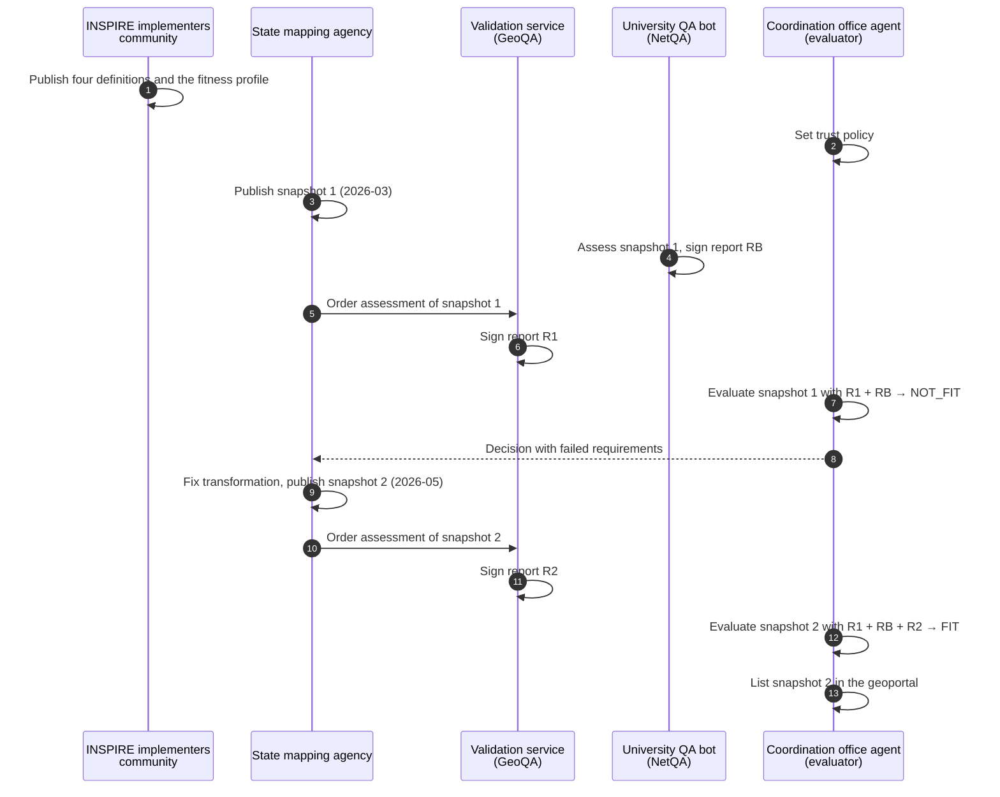
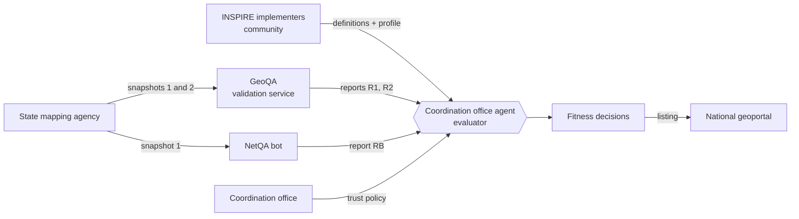
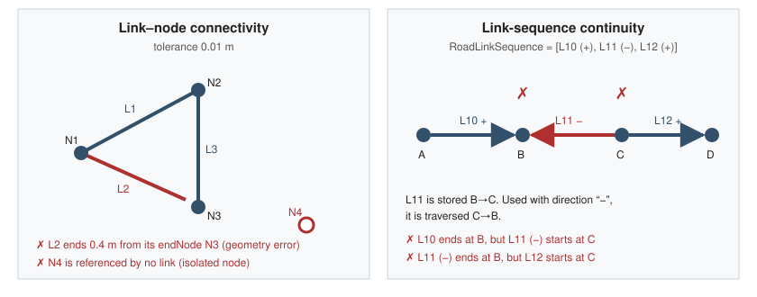
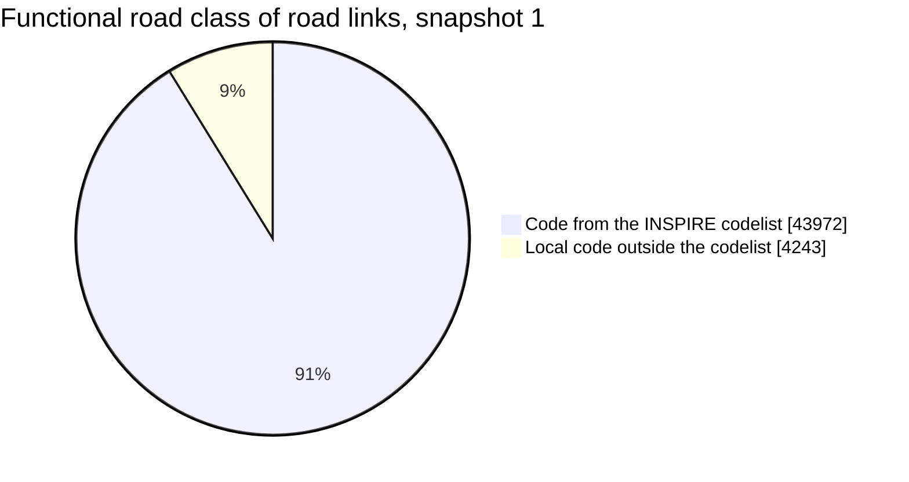
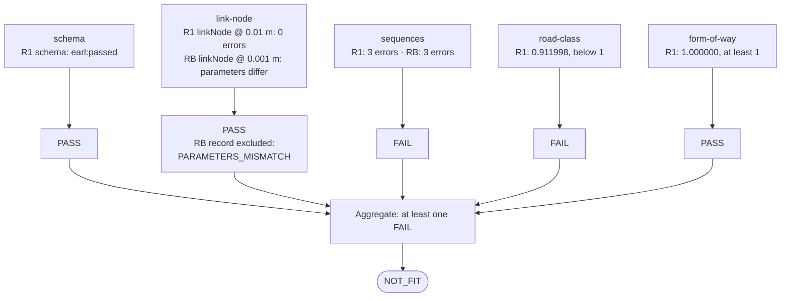
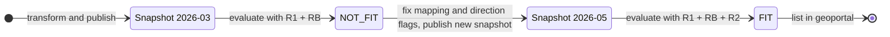

# Checking INSPIRE conformity of a road network

**An end-to-end OFF example · Informative guide to [OFF 0.3 draft](../open-fitness-framework-spec.md)**

> [!NOTE]
> This guide is informative. It explains the specification by example and does not add requirements. The setting is inspired by real practice: a German state mapping agency transforms its authoritative road model into the INSPIRE Road Transport Network schema (TN-Ro 4.0), using the codelists of the INSPIRE registry. The checks are a simplified selection of what INSPIRE requires. All organisations, URLs, identifiers, digests, keys and numbers are invented for illustration, and no real report is claimed. An OFF decision is never a statement of legal compliance ([Section 1](../open-fitness-framework-spec.md#1-scope-and-draft-status)).

A first guide, [Selecting orthoimagery for tree-vitality training data](tree-vitality-orthoimagery.md), follows the same outline for a raster use case.

## Contents

- [The story in one minute](#the-story-in-one-minute)
- [1 The setting and the cast](#1-the-setting-and-the-cast)
- [2 Step 1: The community publishes assertion definitions](#2-step-1-the-community-publishes-assertion-definitions)
- [3 Step 2: The community publishes a fitness profile](#3-step-2-the-community-publishes-a-fitness-profile)
- [4 Step 3: The coordination office sets its trust policy](#4-step-3-the-coordination-office-sets-its-trust-policy)
- [5 Step 4: The mapping agency publishes snapshot 1](#5-step-4-the-mapping-agency-publishes-snapshot-1)
- [6 Step 5: Two validators issue reports](#6-step-5-two-validators-issue-reports)
- [7 Step 6: The first evaluation](#7-step-6-the-first-evaluation)
- [8 Step 7: The agency fixes its transformation](#8-step-7-the-agency-fixes-its-transformation)
- [9 Step 8: Re-evaluation of snapshot 2](#9-step-8-re-evaluation-of-snapshot-2)
- [10 Step 9: Listing the dataset, and what happens next](#10-step-9-listing-the-dataset-and-what-happens-next)
- [11 What this example shows](#11-what-this-example-shows)

## The story in one minute

A state mapping agency publishes its road network in the INSPIRE Road Transport Network schema. Before the national INSPIRE coordination office lists the dataset as conformant in the national geoportal, its agent checks the dataset against a community fitness profile. The profile requires:

- GML that is valid against the INSPIRE schemas;
- correct topology between road links and road nodes;
- continuous road link sequences;
- a functional road class and a form of way for every road link, with codes from the INSPIRE codelists.

Two validators assess snapshot 1. An accredited validation service finds that 8.8 % of the road links carry a local road-class code that is not in the INSPIRE codelist, and that two link sequences are broken. A university QA bot independently finds the same broken sequences; its link–node check uses a stricter tolerance than the profile, so that particular result does not count. Snapshot 1 is **NOT_FIT**.

The agency fixes its transformation and publishes snapshot 2. The validation service assesses it, and snapshot 2 is **FIT**.



## 1 The setting and the cast

The dataset is the regional road network of one German state: about 48,200 road links, 39,900 road nodes and 2,100 road link sequences. The agency maintains the network in its own national data model and transforms it to INSPIRE GML for publication. Errors in such a transformation are common, and they are exactly what the profile is meant to catch: unmapped codes, missing properties, and direction flags turned the wrong way.

| Actor | Fictional organisation | OFF role(s) | What it produces |
| --- | --- | --- | --- |
| Profile and definition publisher | INSPIRE implementers community (`inspire-community.example`) | Profile publisher, definition publisher | Four assertion definitions, one fitness profile |
| Data provider | State mapping agency (`geobasis.example`) | Asset publisher | Snapshots 1 and 2 of the INSPIRE road network |
| Validation service | GeoQA (`geoqa.example`) | Assessor, report issuer | Reports R1 and R2 |
| QA bot | NetQA, run by a university group (`netqa.example`) | Assessor, report issuer | Report RB |
| Consumer | National INSPIRE coordination office (`inspire-coordination.example`) | Trust policy owner; runs the agent, which acts as evaluator | Trust policy, evaluation requests, decisions |



## 2 Step 1: The community publishes assertion definitions

INSPIRE defines what a conformant road network looks like, but not how a machine should report the result of checking one. The implementers community fills this gap with four `AssertionDefinition` documents ([Section 7.1](../open-fitness-framework-spec.md#71-definition-contract)). In all of them, the prefix `tn-ro` denotes the TN-Ro 4.0 namespace `http://inspire.ec.europa.eu/schemas/tn-ro/4.0`.

| Short name | Kind | Value | What it means |
| --- | --- | --- | --- |
| `xsd-validity/1.0` | test | passed or failed | Every GML file of the snapshot is valid against a pinned bundle of XML schemas. |
| `link-node-connectivity-errors/1.0` | measurement | integer, count | Number of link–node topology errors at a given tolerance. |
| `link-sequence-continuity-errors/1.0` | measurement | integer, count | Number of broken junctions between consecutive members of link sequences. |
| `network-property-population/1.0` | measurement | decimal, unitless, 0–1 | Share of links that carry exactly one whole-link network property of a given type, with a code from a pinned codelist. |

### Schema validity

The test passes if every GML file validates against the schemas in the `schemaBundle` parameter: a pinned archive containing the TN-Ro 4.0 schema and everything it imports, including GML 3.2.1 and the INSPIRE base schemas. The validator must resolve imports only from the bundle, never from the web. Otherwise a change on a schema server could change the result without anybody noticing, which is exactly what pinning prevents ([Section 4.3](../open-fitness-framework-spec.md#43-references-and-digests)).

The definition settles the cases that adapters tend to get wrong ([Section 7.2](../open-fitness-framework-spec.md#72-schema-conformity-pattern)):

- Validator warnings do not fail the test.
- A file that is not well-formed XML fails the test.
- A validator crash or time-out is `earl:cantTell` with reason EXECUTION_ERROR, never `earl:failed`.

### Topology as error counts

Both topology definitions count errors rather than returning pass or fail. A profile that needs a perfect network requires a count of 0. A more lenient profile, for example for rough routing studies, could accept up to 10 errors using the same reports. The counts also show how bad a failure is.

`link-node-connectivity-errors/1.0` counts three kinds of errors among the features of the given link and node types:

- a link whose `startNode` or `endNode` is missing or cannot be resolved;
- a link end that is farther than `toleranceMetres` from the position of the node it references;
- a node that no link references (an isolated node).

`link-sequence-continuity-errors/1.0` walks through every link sequence. A sequence consists of directed links: `+` means the link is traversed from its start node to its end node, and `−` the other way round. A *broken junction* is a pair of consecutive members where the first one's exit node is not the second one's entry node, or where a member references a link that cannot be resolved.



### Network properties in full

In INSPIRE, functional road class and form of way are not attributes of a road link. They are separate *network property* features, `tn-ro:FunctionalRoadClass` and `tn-ro:FormOfWay`, that point to links through `networkRef`. A property can apply to a whole link or, through linear referencing, to a part of it. A definition that just counted "links with a value" would therefore be ambiguous. This one states its denominator and numerator precisely, and the same definition serves both properties through its parameters:

```json
{
  "specVersion": "0.3-draft",
  "type": "AssertionDefinition",
  "id": "https://defs.inspire-community.example/network-property-population/1.0",
  "version": "1.0.0",
  "kind": "measurement",
  "name": "Population of a codelist-valued network property on links",
  "assessedProperty": "Whether every link of a network carries exactly one whole-link network property of a given type whose value is a code of a pinned codelist.",
  "parameterSchema": {
    "type": "object",
    "required": ["linkType", "propertyType", "valueProperty", "codelist"],
    "additionalProperties": false,
    "properties": {
      "linkType": { "type": "string" },
      "propertyType": { "type": "string" },
      "valueProperty": { "type": "string" },
      "codelist": {
        "type": "object",
        "required": ["id", "digest"],
        "properties": { "id": { "type": "string" }, "digest": { "type": "object" } }
      }
    }
  },
  "interpretation": "The denominator is the number of features of linkType. The numerator is the number of those links that are referenced, through networkRef without linear referencing or with a linear reference covering the whole link, by exactly one feature of propertyType, and whose valueProperty is a code URI contained in the pinned codelist release. The value is numerator divided by denominator, truncated downward to six decimal places. In type names, the prefix tn-ro denotes http://inspire.ec.europa.eu/schemas/tn-ro/4.0.",
  "indeterminateCases": [
    "The snapshot contains no feature of linkType: inconclusive, no value.",
    "The codelist release cannot be read: error, no value.",
    "Property features cannot be associated with links because networkRef targets cannot be resolved for more than 1 % of property features: inconclusive, no value."
  ],
  "valueType": "decimal",
  "unit": "http://qudt.org/vocab/unit/UNITLESS",
  "range": { "minimum": "0", "maximum": "1" },
  "requiredDetails": {
    "links": "Number of links (denominator), as an integer string.",
    "populated": "Number of links counted in the numerator, as an integer string.",
    "missing": "Number of links referenced by no property feature of propertyType, as an integer string.",
    "invalidCode": "Number of links whose single whole-link property has a value outside the codelist, as an integer string.",
    "multipleOrPartial": "Number of links with more than one property feature of propertyType, or only partial coverage, as an integer string."
  },
  "dimension": "https://defs.inspire-community.example/dimensions/domain-consistency"
}
```

The `codelist` parameter pins one release of an INSPIRE registry codelist. Its `id` is the codelist URI, for example `http://inspire.ec.europa.eu/codelist/FunctionalRoadClassValue`. Registry codelists evolve; the digest identifies the exact release the profile means, and a resolver can serve those bytes from a local copy ([Section 4.3](../open-fitness-framework-spec.md#43-references-and-digests)).

## 3 Step 2: The community publishes a fitness profile

The community's profile bundles the checks into one purpose: technical conformity of road networks published under INSPIRE, in a simplified form.

| Requirement | Definition | Parameters | Condition |
| --- | --- | --- | --- |
| `schema` | xsd-validity | TN-Ro 4.0 schema bundle | passed |
| `link-node` | link-node-connectivity-errors | RoadLink, RoadNode, tolerance 0.01 m | = 0 |
| `sequences` | link-sequence-continuity-errors | RoadLinkSequence, RoadLink | = 0 |
| `road-class` | network-property-population | FunctionalRoadClass, FunctionalRoadClassValue codelist | ≥ 1 |
| `form-of-way` | network-property-population | FormOfWay, FormOfWayValue codelist | ≥ 1 |

The last two requirements use the same definition with different parameters. For the evaluator, they are as distinct as two different definitions, because matching uses definition *and* parameters ([Section 5.2](../open-fitness-framework-spec.md#52-requirements)).

```json
{
  "specVersion": "0.3-draft",
  "type": "FitnessProfile",
  "id": "https://inspire-community.example/profiles/tn-ro-technical-conformity",
  "version": "1.0.0",
  "name": "INSPIRE Road Transport Network, simplified technical conformity",
  "purpose": {
    "id": "https://inspire-community.example/purposes/inspire-tn-ro-publication",
    "description": "Publish a road network as an INSPIRE Road Transport Network (TN-Ro 4.0) dataset whose schema, network topology and codelist-controlled properties are technically correct. Covers a simplified subset of INSPIRE requirements; not a statement of legal compliance."
  },
  "requirements": [
    {
      "id": "schema",
      "description": "All GML files are valid against the TN-Ro 4.0 schemas.",
      "statement": {
        "definition": {
          "id": "https://defs.inspire-community.example/xsd-validity/1.0",
          "digest": { "algorithm": "sha-256", "value": "92b9af8294236abe0074c54b70be6a642196bef227e6129da86ff8bcecd21230" }
        },
        "parameters": {
          "schemaBundle": {
            "id": "https://inspire-community.example/bundles/tn-ro-4.0-schemas.zip",
            "digest": { "algorithm": "sha-256", "value": "59ec626e40a918e61c887d8a9ac027c7a4a6c36a5c28e76258e5f3efc0fa4fa7" }
          }
        }
      },
      "condition": { "operator": "eq", "expected": { "type": "boolean", "value": true } }
    },
    {
      "id": "link-node",
      "description": "No link–node topology errors at a tolerance of 1 cm.",
      "statement": {
        "definition": {
          "id": "https://defs.inspire-community.example/link-node-connectivity-errors/1.0",
          "digest": { "algorithm": "sha-256", "value": "e326420db11ddb93cbac62d01b3eaa6d39c9232ac41265ae4d7b867d96331def" }
        },
        "parameters": { "linkType": "tn-ro:RoadLink", "nodeType": "tn-ro:RoadNode", "toleranceMetres": "0.01" }
      },
      "condition": {
        "operator": "eq",
        "expected": { "type": "integer", "value": "0", "unit": "http://qudt.org/vocab/unit/NUM" }
      }
    },
    {
      "id": "sequences",
      "description": "All road link sequences are continuous.",
      "statement": {
        "definition": {
          "id": "https://defs.inspire-community.example/link-sequence-continuity-errors/1.0",
          "digest": { "algorithm": "sha-256", "value": "ef0064591238dd9258d2bb6ad10e1135a41522de0d94d9499a409898b6c66cca" }
        },
        "parameters": { "sequenceType": "tn-ro:RoadLinkSequence", "linkType": "tn-ro:RoadLink" }
      },
      "condition": {
        "operator": "eq",
        "expected": { "type": "integer", "value": "0", "unit": "http://qudt.org/vocab/unit/NUM" }
      }
    },
    {
      "id": "road-class",
      "description": "Every road link has exactly one functional road class from the INSPIRE codelist.",
      "statement": {
        "definition": {
          "id": "https://defs.inspire-community.example/network-property-population/1.0",
          "digest": { "algorithm": "sha-256", "value": "a79dc4f1d27294af788d32ed2af23afebc5b9c1e4a275290ec73be3a14e28ba1" }
        },
        "parameters": {
          "linkType": "tn-ro:RoadLink",
          "propertyType": "tn-ro:FunctionalRoadClass",
          "valueProperty": "functionalRoadClass",
          "codelist": {
            "id": "http://inspire.ec.europa.eu/codelist/FunctionalRoadClassValue",
            "digest": { "algorithm": "sha-256", "value": "7965e401989285f07c5a357dd5cf12ea4c598ff9da83efc3d4343f38cbdd90e9" }
          }
        }
      },
      "condition": {
        "operator": "gte",
        "expected": { "type": "decimal", "value": "1", "unit": "http://qudt.org/vocab/unit/UNITLESS" }
      }
    },
    {
      "id": "form-of-way",
      "description": "Every road link has exactly one form of way from the INSPIRE codelist.",
      "statement": {
        "definition": {
          "id": "https://defs.inspire-community.example/network-property-population/1.0",
          "digest": { "algorithm": "sha-256", "value": "a79dc4f1d27294af788d32ed2af23afebc5b9c1e4a275290ec73be3a14e28ba1" }
        },
        "parameters": {
          "linkType": "tn-ro:RoadLink",
          "propertyType": "tn-ro:FormOfWay",
          "valueProperty": "formOfWay",
          "codelist": {
            "id": "http://inspire.ec.europa.eu/codelist/FormOfWayValue",
            "digest": { "algorithm": "sha-256", "value": "c030d7539510aa38da1cf6f7e4a19fc9168651a8e8a9c107a99f07b8298b1f30" }
          }
        }
      },
      "condition": {
        "operator": "gte",
        "expected": { "type": "decimal", "value": "1", "unit": "http://qudt.org/vocab/unit/UNITLESS" }
      }
    }
  ]
}
```

Two choices in this profile are worth noting:

- **The tolerance is a parameter, so it is part of what is asserted.** A link–node error count at 1 cm and one at 1 mm are different measurements. Neither is "the" topology of the network.
- **"Fully populated" is written as ≥ 1.** The value cannot exceed 1, so `gte` and `eq` behave the same here. `gte` keeps the profile valid if the definition's range were ever widened, and it reads as a minimum, like the thresholds in other profiles.

## 4 Step 3: The coordination office sets its trust policy

The coordination office decides whose evidence it accepts ([Section 8.2](../open-fitness-framework-spec.md#82-local-trust-policy)):

| Issuer | Trusted for | Reasoning |
| --- | --- | --- |
| GeoQA validation service | all four definitions | Accredited, independent of the data provider, publishes its methods. |
| NetQA university bot | the two topology definitions | Open-source checks with a good track record on network topology. |

The data provider itself is not a trusted issuer. The agency runs its own checks during the transformation, but the coordination office wants independent evidence before it calls a dataset conformant. Assessments may be at most one year old.

```json
{
  "specVersion": "0.3-draft",
  "type": "TrustPolicy",
  "id": "https://inspire-coordination.example/policies/geoportal-listing",
  "version": "2",
  "trustedIssuers": [
    {
      "issuer": "https://geoqa.example/issuer",
      "keys": [
        {
          "id": "https://geoqa.example/issuer#2026",
          "algorithm": "ES256",
          "key": { "kty": "EC", "crv": "P-256", "x": "0B7HAwiYyP2HLA0qXC8WZpHXrlLCTzke7hFgp4WIJLQ", "y": "0IVBUUVUxiQK4F8LYJByz2j0GvarajNoFyggtj0usZk" }
        }
      ],
      "allowedDefinitions": [
        { "id": "https://defs.inspire-community.example/xsd-validity/1.0", "digest": { "algorithm": "sha-256", "value": "92b9af8294236abe0074c54b70be6a642196bef227e6129da86ff8bcecd21230" } },
        { "id": "https://defs.inspire-community.example/link-node-connectivity-errors/1.0", "digest": { "algorithm": "sha-256", "value": "e326420db11ddb93cbac62d01b3eaa6d39c9232ac41265ae4d7b867d96331def" } },
        { "id": "https://defs.inspire-community.example/link-sequence-continuity-errors/1.0", "digest": { "algorithm": "sha-256", "value": "ef0064591238dd9258d2bb6ad10e1135a41522de0d94d9499a409898b6c66cca" } },
        { "id": "https://defs.inspire-community.example/network-property-population/1.0", "digest": { "algorithm": "sha-256", "value": "a79dc4f1d27294af788d32ed2af23afebc5b9c1e4a275290ec73be3a14e28ba1" } }
      ]
    },
    {
      "issuer": "https://netqa.example/issuer",
      "keys": [
        {
          "id": "https://netqa.example/issuer#bot-1",
          "algorithm": "ES256",
          "key": { "kty": "EC", "crv": "P-256", "x": "7v7rFtPyjJemH3nwBQ4MxfUKNflUn3Ch-ebZSnpxIg8", "y": "7_XiowMqqM1OU1WoWKFxMPertm9qVzx4vdqC1eyp6ns" }
        }
      ],
      "allowedDefinitions": [
        { "id": "https://defs.inspire-community.example/link-node-connectivity-errors/1.0", "digest": { "algorithm": "sha-256", "value": "e326420db11ddb93cbac62d01b3eaa6d39c9232ac41265ae4d7b867d96331def" } },
        { "id": "https://defs.inspire-community.example/link-sequence-continuity-errors/1.0", "digest": { "algorithm": "sha-256", "value": "ef0064591238dd9258d2bb6ad10e1135a41522de0d94d9499a409898b6c66cca" } }
      ]
    }
  ],
  "maxAssessmentAgeSeconds": 31536000
}
```

## 5 Step 4: The mapping agency publishes snapshot 1

The agency publishes the INSPIRE dataset as a set of GML files, one per district. A manifest lists every file with its digest, and the snapshot is bound to the manifest's digest ([Section 4.4](../open-fitness-framework-spec.md#44-data-asset-binding)).

| Field | Snapshot 1 |
| --- | --- |
| `assetId` | `https://geobasis.example/inspire/tn-ro` |
| `representationId` | `https://geobasis.example/inspire/tn-ro/gml` |
| `snapshotId` | `https://geobasis.example/inspire/tn-ro/snapshots/2026-03` |
| `digestKind` | `manifest` (36 GML files) |
| Content | 48,215 RoadLink, 39,870 RoadNode, 2,114 RoadLinkSequence, 48,215 FunctionalRoadClass and 48,215 FormOfWay features |

Snapshot 1 has two transformation bugs that nobody has noticed yet:

- **Unmapped road classes.** The national model classifies district roads with a local class that the transformation passes through as a URI outside the INSPIRE codelist. This affects 4,243 road links.
- **Direction flags.** For links digitised against the direction of a route, the transformation writes `+` instead of `−` into the sequence. This breaks two road link sequences at three junctions.

## 6 Step 5: Two validators issue reports

### Report RB: the university bot

NetQA's bot crawls the geoportal's candidate datasets and checks the topology of every new snapshot. It ran on snapshot 1 two days after publication. Its link–node check uses a tolerance of 1 mm, the bot's default; at that tolerance it counts 41 errors, mostly link ends a few millimetres off their nodes. Its sequence check uses the same parameters as the profile and finds the three broken junctions. The two records of its report body, signed with key `bot-1`:

```json
"assertions": [
  {
    "id": "linkNode",
    "kind": "measurement",
    "definition": {
      "id": "https://defs.inspire-community.example/link-node-connectivity-errors/1.0",
      "digest": { "algorithm": "sha-256", "value": "e326420db11ddb93cbac62d01b3eaa6d39c9232ac41265ae4d7b867d96331def" }
    },
    "parameters": { "linkType": "tn-ro:RoadLink", "nodeType": "tn-ro:RoadNode", "toleranceMetres": "0.001" },
    "executionStatus": "completed",
    "value": { "type": "integer", "value": "41", "unit": "http://qudt.org/vocab/unit/NUM" },
    "details": { "unresolvedReference": "0", "geometryMismatch": "41", "isolatedNode": "0" },
    "evidence": ["errors"],
    "limitations": []
  },
  {
    "id": "sequences",
    "kind": "measurement",
    "definition": {
      "id": "https://defs.inspire-community.example/link-sequence-continuity-errors/1.0",
      "digest": { "algorithm": "sha-256", "value": "ef0064591238dd9258d2bb6ad10e1135a41522de0d94d9499a409898b6c66cca" }
    },
    "parameters": { "sequenceType": "tn-ro:RoadLinkSequence", "linkType": "tn-ro:RoadLink" },
    "executionStatus": "completed",
    "value": { "type": "integer", "value": "3", "unit": "http://qudt.org/vocab/unit/NUM" },
    "details": { "sequences": "2114", "affectedSequences": "2" },
    "evidence": ["errors"],
    "limitations": []
  }
]
```

The rest of RB follows the same pattern as R1 below: report id `https://netqa.example/reports/geobasis-tn-ro-2026-03`, issuer `https://netqa.example/issuer`, subject snapshot 1, assessment `earl:automatic` ended 2026-03-18T02:10:00Z, and one evidence item with the error locations as GeoJSON.

### Report R1: the validation service

The agency orders an assessment from GeoQA, which runs all five checks of the profile on snapshot 1 and signs report R1. Below is the full report body. The credential around it carries report id `https://geoqa.example/reports/2026-0311`, issuer `https://geoqa.example/issuer`, `validFrom` 2026-03-21T09:00:00Z and `validUntil` 2027-03-21T09:00:00Z, and is signed with GeoQA's key `#2026` ([Section 6.1](../open-fitness-framework-spec.md#61-credential-structure)).

```json
{
  "specVersion": "0.3-draft",
  "subject": {
    "assetId": "https://geobasis.example/inspire/tn-ro",
    "representationId": "https://geobasis.example/inspire/tn-ro/gml",
    "snapshotId": "https://geobasis.example/inspire/tn-ro/snapshots/2026-03",
    "digestKind": "manifest",
    "digest": { "algorithm": "sha-256", "value": "0c53973e9e839e03bf8f2440fdfda181371415a5dd89496bde27f18b3a92694b" }
  },
  "scope": { "kind": "whole" },
  "coverage": { "kind": "complete" },
  "issuedAt": "2026-03-21T09:00:00Z",
  "assessment": {
    "id": "https://geoqa.example/runs/2026-0311",
    "operator": "https://geoqa.example/issuer",
    "mode": "earl:automatic",
    "method": {
      "id": "https://geoqa.example/methods/inspire-network-suite/3",
      "digest": { "algorithm": "sha-256", "value": "9d0fecfe5e92db5f6bffd8517054c4cfccafc0c61b1fb501a322baf5fefdf97c" }
    },
    "endedAt": "2026-03-20T22:47:00Z",
    "tools": [
      { "id": "https://geoqa.example/tools/xml-validator", "version": "12.4" },
      { "id": "https://geoqa.example/tools/network-checker", "version": "3.0.2" }
    ]
  },
  "assertions": [
    {
      "id": "schema",
      "kind": "test",
      "definition": {
        "id": "https://defs.inspire-community.example/xsd-validity/1.0",
        "digest": { "algorithm": "sha-256", "value": "92b9af8294236abe0074c54b70be6a642196bef227e6129da86ff8bcecd21230" }
      },
      "parameters": {
        "schemaBundle": {
          "id": "https://inspire-community.example/bundles/tn-ro-4.0-schemas.zip",
          "digest": { "algorithm": "sha-256", "value": "59ec626e40a918e61c887d8a9ac027c7a4a6c36a5c28e76258e5f3efc0fa4fa7" }
        }
      },
      "result": { "outcome": "earl:passed" },
      "details": { "files": "36", "warnings": "0" },
      "evidence": ["log"],
      "limitations": []
    },
    {
      "id": "linkNode",
      "kind": "measurement",
      "definition": {
        "id": "https://defs.inspire-community.example/link-node-connectivity-errors/1.0",
        "digest": { "algorithm": "sha-256", "value": "e326420db11ddb93cbac62d01b3eaa6d39c9232ac41265ae4d7b867d96331def" }
      },
      "parameters": { "linkType": "tn-ro:RoadLink", "nodeType": "tn-ro:RoadNode", "toleranceMetres": "0.01" },
      "executionStatus": "completed",
      "value": { "type": "integer", "value": "0", "unit": "http://qudt.org/vocab/unit/NUM" },
      "details": { "unresolvedReference": "0", "geometryMismatch": "0", "isolatedNode": "0" },
      "evidence": ["log"],
      "limitations": []
    },
    {
      "id": "sequences",
      "kind": "measurement",
      "definition": {
        "id": "https://defs.inspire-community.example/link-sequence-continuity-errors/1.0",
        "digest": { "algorithm": "sha-256", "value": "ef0064591238dd9258d2bb6ad10e1135a41522de0d94d9499a409898b6c66cca" }
      },
      "parameters": { "sequenceType": "tn-ro:RoadLinkSequence", "linkType": "tn-ro:RoadLink" },
      "executionStatus": "completed",
      "value": { "type": "integer", "value": "3", "unit": "http://qudt.org/vocab/unit/NUM" },
      "details": { "sequences": "2114", "affectedSequences": "2" },
      "evidence": ["log", "errors"],
      "limitations": []
    },
    {
      "id": "roadClass",
      "kind": "measurement",
      "definition": {
        "id": "https://defs.inspire-community.example/network-property-population/1.0",
        "digest": { "algorithm": "sha-256", "value": "a79dc4f1d27294af788d32ed2af23afebc5b9c1e4a275290ec73be3a14e28ba1" }
      },
      "parameters": {
        "linkType": "tn-ro:RoadLink",
        "propertyType": "tn-ro:FunctionalRoadClass",
        "valueProperty": "functionalRoadClass",
        "codelist": {
          "id": "http://inspire.ec.europa.eu/codelist/FunctionalRoadClassValue",
          "digest": { "algorithm": "sha-256", "value": "7965e401989285f07c5a357dd5cf12ea4c598ff9da83efc3d4343f38cbdd90e9" }
        }
      },
      "executionStatus": "completed",
      "value": { "type": "decimal", "value": "0.911998", "unit": "http://qudt.org/vocab/unit/UNITLESS" },
      "details": { "links": "48215", "populated": "43972", "missing": "0", "invalidCode": "4243", "multipleOrPartial": "0" },
      "evidence": ["log", "errors"],
      "limitations": []
    },
    {
      "id": "formOfWay",
      "kind": "measurement",
      "definition": {
        "id": "https://defs.inspire-community.example/network-property-population/1.0",
        "digest": { "algorithm": "sha-256", "value": "a79dc4f1d27294af788d32ed2af23afebc5b9c1e4a275290ec73be3a14e28ba1" }
      },
      "parameters": {
        "linkType": "tn-ro:RoadLink",
        "propertyType": "tn-ro:FormOfWay",
        "valueProperty": "formOfWay",
        "codelist": {
          "id": "http://inspire.ec.europa.eu/codelist/FormOfWayValue",
          "digest": { "algorithm": "sha-256", "value": "c030d7539510aa38da1cf6f7e4a19fc9168651a8e8a9c107a99f07b8298b1f30" }
        }
      },
      "executionStatus": "completed",
      "value": { "type": "decimal", "value": "1.000000", "unit": "http://qudt.org/vocab/unit/UNITLESS" },
      "details": { "links": "48215", "populated": "48215", "missing": "0", "invalidCode": "0", "multipleOrPartial": "0" },
      "evidence": ["log"],
      "limitations": []
    }
  ],
  "evidence": [
    {
      "id": "log",
      "resource": {
        "id": "https://geoqa.example/runs/2026-0311/log.json",
        "digest": { "algorithm": "sha-256", "value": "0af723ee2e3e65be68326517eae316c8c4f026f457bbd65542d211d7cf039be6" }
      },
      "href": "https://geoqa.example/runs/2026-0311/log.json",
      "mediaType": "application/json",
      "role": "log"
    },
    {
      "id": "errors",
      "resource": {
        "id": "https://geoqa.example/runs/2026-0311/errors.geojson",
        "digest": { "algorithm": "sha-256", "value": "09cb8e004037c57ee4aaba54792d8e40416952b64b6cfe37f26910e6fb2c677e" }
      },
      "href": "https://geoqa.example/runs/2026-0311/errors.geojson",
      "mediaType": "application/geo+json",
      "role": "result",
      "description": "Locations and identifiers of every broken junction and every link with an invalid road-class code."
    }
  ]
}
```

The value 0.911998 is 43,972 ÷ 48,215 truncated to six decimal places, as the definition prescribes. The road-class codes break down like this:



## 7 Step 6: The first evaluation

The coordination office's agent picks up snapshot 1 from the list of datasets waiting to be listed. It knows two reports for it, R1 and RB, and pins both in an evaluation request ([Section 9](../open-fitness-framework-spec.md#9-evaluation-requests)):

```json
{
  "specVersion": "0.3-draft",
  "type": "EvaluationRequest",
  "id": "https://inspire-coordination.example/evaluations/2026-03-23-geobasis-tn-ro",
  "subject": {
    "assetId": "https://geobasis.example/inspire/tn-ro",
    "representationId": "https://geobasis.example/inspire/tn-ro/gml",
    "snapshotId": "https://geobasis.example/inspire/tn-ro/snapshots/2026-03",
    "digestKind": "manifest",
    "digest": { "algorithm": "sha-256", "value": "0c53973e9e839e03bf8f2440fdfda181371415a5dd89496bde27f18b3a92694b" }
  },
  "scope": { "kind": "whole" },
  "purpose": "https://inspire-community.example/purposes/inspire-tn-ro-publication",
  "profile": {
    "id": "https://inspire-community.example/profiles/tn-ro-technical-conformity/1.0.0.json",
    "digest": { "algorithm": "sha-256", "value": "ca034b635d422769a0d0f3fcebdda41d1b67d5ef9baf9a0e4743d5958b6f3705" }
  },
  "trustPolicy": {
    "id": "https://inspire-coordination.example/policies/geoportal-listing/2.json",
    "digest": { "algorithm": "sha-256", "value": "c612d1db4c7ea8e360b5bfbcdf6f7f5f9fe6d7888ef9e5533258457c055dab3e" }
  },
  "evaluatedAt": "2026-03-23T07:00:00Z",
  "reportResources": [
    {
      "id": "https://geoqa.example/reports/2026-0311.jwt",
      "digest": { "algorithm": "sha-256", "value": "cdb98c493015b931dc756672eb5f0382f38a226a39558f5e27fadec9bb89d76a" }
    },
    {
      "id": "https://netqa.example/reports/geobasis-tn-ro-2026-03.jwt",
      "digest": { "algorithm": "sha-256", "value": "e082a33a791aa78b586556cdc9e61cc9bc9bee75b55baeed5c2e44aaa8e9eaaf" }
    }
  ]
}
```

### What the evaluator does

Both reports authenticate: both issuers are trusted, the subject bindings equal the request's, and both assessments are a few days old. Then the evaluator matches records to requirements ([Section 10.3](../open-fitness-framework-spec.md#103-select-and-admit-records)):



Three points deserve a closer look:

- **The bot's 41 errors are not a conflict.** They count errors at 1 mm, while the profile asks about 1 cm. Both numbers can be true at once. The evaluator lists the bot's record in the `link-node` trace with PARAMETERS_MISMATCH ([Section 10.3](../open-fitness-framework-spec.md#103-select-and-admit-records)), so a reader of the decision sees that this evidence existed and why it did not count. R1's `formOfWay` record, by contrast, is not listed under `road-class`, even though it uses the same definition with other parameters: it matches the `form-of-way` requirement exactly, so it is not evidence about different parameters but evidence for another requirement.
- **Two independent issuers agree on the sequences.** Both records are admitted and both violate `= 0`. Agreement does not make the FAIL stronger, since OFF does not count votes, but both appear in the trace.
- **`1.000000 ≥ 1` holds.** Trailing zeros have no numerical effect ([Section 4.2](../open-fitness-framework-spec.md#42-values-and-timestamps)).

### Decision for snapshot 1: NOT_FIT

```json
{
  "specVersion": "0.3-draft",
  "type": "FitnessDecision",
  "id": "https://inspire-coordination.example/decisions/2026-03-23-geobasis-tn-ro",
  "request": {
    "id": "https://inspire-coordination.example/evaluations/2026-03-23-geobasis-tn-ro.json",
    "digest": { "algorithm": "sha-256", "value": "f0e974b890a343d3559a57db8f2f2e631a97644b125d0a051dc9aee528a7d509" }
  },
  "evaluator": { "id": "https://inspire-coordination.example/agent/off-evaluator", "version": "1.4.0" },
  "decidedAt": "2026-03-23T07:00:09Z",
  "evaluationStatus": "completed",
  "result": "NOT_FIT",
  "requirementResults": [
    {
      "id": "schema",
      "outcome": "PASS",
      "reasons": ["PREDICATE_SATISFIED"],
      "acceptedTrace": [{ "report": "https://geoqa.example/reports/2026-0311", "assertion": "schema", "predicate": "PASS" }],
      "excludedTrace": []
    },
    {
      "id": "link-node",
      "outcome": "PASS",
      "reasons": ["PREDICATE_SATISFIED"],
      "acceptedTrace": [{ "report": "https://geoqa.example/reports/2026-0311", "assertion": "linkNode", "predicate": "PASS" }],
      "excludedTrace": [
        { "report": "https://netqa.example/reports/geobasis-tn-ro-2026-03", "assertion": "linkNode", "reasons": ["PARAMETERS_MISMATCH"] }
      ]
    },
    {
      "id": "sequences",
      "outcome": "FAIL",
      "reasons": ["PREDICATE_VIOLATED"],
      "acceptedTrace": [
        { "report": "https://geoqa.example/reports/2026-0311", "assertion": "sequences", "predicate": "FAIL" },
        { "report": "https://netqa.example/reports/geobasis-tn-ro-2026-03", "assertion": "sequences", "predicate": "FAIL" }
      ],
      "excludedTrace": []
    },
    {
      "id": "road-class",
      "outcome": "FAIL",
      "reasons": ["PREDICATE_VIOLATED"],
      "acceptedTrace": [{ "report": "https://geoqa.example/reports/2026-0311", "assertion": "roadClass", "predicate": "FAIL" }],
      "excludedTrace": []
    },
    {
      "id": "form-of-way",
      "outcome": "PASS",
      "reasons": ["PREDICATE_SATISFIED"],
      "acceptedTrace": [{ "report": "https://geoqa.example/reports/2026-0311", "assertion": "formOfWay", "predicate": "PASS" }],
      "excludedTrace": []
    }
  ],
  "errors": [],
  "limitations": [
    "Submitted-only evidence set; no discovery was performed by the evaluator.",
    "No revocation channel was checked."
  ]
}
```

The coordination office sends this decision to the agency. It is a precise to-do list: two requirements failed, and the traces point to the records whose details and evidence explain why. GeoQA's `errors.geojson` gives the exact locations.

## 8 Step 7: The agency fixes its transformation

The agency's transformation team corrects both bugs:

- The local district-road class is now mapped to the INSPIRE code `http://inspire.ec.europa.eu/codelist/FunctionalRoadClassValue/fourthClass`, as agreed with the coordination office.
- Direction flags are now derived from the digitisation direction of each link relative to its route.

The fixed data is a new state of the asset, so the agency publishes it as a new snapshot, `https://geobasis.example/inspire/tn-ro/snapshots/2026-05`, with manifest digest `e46cf2f1…e92e`. Snapshot 1 stays available unchanged; its decision remains a valid record of why it was not listed.



GeoQA assesses snapshot 2 with the same method and signs report R2 (`https://geoqa.example/reports/2026-0514`, assessment ended 2026-05-13T21:30:00Z, issued 2026-05-14T09:00:00Z). It has the same five records as R1, with these values:

| Record | Snapshot 1 (R1) | Snapshot 2 (R2) |
| --- | --- | --- |
| `schema` | `earl:passed` | `earl:passed` |
| `linkNode` (0.01 m) | 0 | 0 |
| `sequences` | 3 | 0 |
| `roadClass` | 0.911998 | 1.000000 |
| `formOfWay` | 1.000000 | 1.000000 |

The bot has not yet run on snapshot 2.

## 9 Step 8: Re-evaluation of snapshot 2

The agent evaluates snapshot 2. It passes every report it knows for the asset, including the two about snapshot 1, and leaves it to the evaluation procedure to sort out which apply. The request is `https://inspire-coordination.example/evaluations/2026-05-15-geobasis-tn-ro`, with `evaluatedAt` 2026-05-15T07:00:00Z, the snapshot 2 binding as `subject`, and these `reportResources`:

```json
"reportResources": [
  {
    "id": "https://geoqa.example/reports/2026-0311.jwt",
    "digest": { "algorithm": "sha-256", "value": "cdb98c493015b931dc756672eb5f0382f38a226a39558f5e27fadec9bb89d76a" }
  },
  {
    "id": "https://netqa.example/reports/geobasis-tn-ro-2026-03.jwt",
    "digest": { "algorithm": "sha-256", "value": "e082a33a791aa78b586556cdc9e61cc9bc9bee75b55baeed5c2e44aaa8e9eaaf" }
  },
  {
    "id": "https://geoqa.example/reports/2026-0514.jwt",
    "digest": { "algorithm": "sha-256", "value": "5b7d11b4dc2fcca9969f80f1b40f23a38d3283a5df8ed3a097c8380e76c46551" }
  }
]
```

R1 and RB are about snapshot 1. Their subject binding does not equal the request's, so both are excluded with SUBJECT_MISMATCH before any record is matched ([Section 10.2](../open-fitness-framework-spec.md#102-authenticate-reports-and-check-identity)). In particular, R1's old FAIL records cannot contradict R2: evidence about a different snapshot is no evidence at all. Only R2 remains, and all five requirements pass.

```json
{
  "specVersion": "0.3-draft",
  "type": "FitnessDecision",
  "id": "https://inspire-coordination.example/decisions/2026-05-15-geobasis-tn-ro",
  "request": {
    "id": "https://inspire-coordination.example/evaluations/2026-05-15-geobasis-tn-ro.json",
    "digest": { "algorithm": "sha-256", "value": "1a5cb68df55ed221219f7f1d3a2b0d2e30597296d4da1af93d69682d45eb23f4" }
  },
  "evaluator": { "id": "https://inspire-coordination.example/agent/off-evaluator", "version": "1.4.0" },
  "decidedAt": "2026-05-15T07:00:07Z",
  "evaluationStatus": "completed",
  "result": "FIT",
  "requirementResults": [
    {
      "id": "schema",
      "outcome": "PASS",
      "reasons": ["PREDICATE_SATISFIED"],
      "acceptedTrace": [{ "report": "https://geoqa.example/reports/2026-0514", "assertion": "schema", "predicate": "PASS" }],
      "excludedTrace": [{ "report": "https://geoqa.example/reports/2026-0311", "reasons": ["SUBJECT_MISMATCH"] }]
    },
    {
      "id": "link-node",
      "outcome": "PASS",
      "reasons": ["PREDICATE_SATISFIED"],
      "acceptedTrace": [{ "report": "https://geoqa.example/reports/2026-0514", "assertion": "linkNode", "predicate": "PASS" }],
      "excludedTrace": [
        { "report": "https://geoqa.example/reports/2026-0311", "reasons": ["SUBJECT_MISMATCH"] },
        { "report": "https://netqa.example/reports/geobasis-tn-ro-2026-03", "reasons": ["SUBJECT_MISMATCH"] }
      ]
    },
    {
      "id": "sequences",
      "outcome": "PASS",
      "reasons": ["PREDICATE_SATISFIED"],
      "acceptedTrace": [{ "report": "https://geoqa.example/reports/2026-0514", "assertion": "sequences", "predicate": "PASS" }],
      "excludedTrace": [
        { "report": "https://geoqa.example/reports/2026-0311", "reasons": ["SUBJECT_MISMATCH"] },
        { "report": "https://netqa.example/reports/geobasis-tn-ro-2026-03", "reasons": ["SUBJECT_MISMATCH"] }
      ]
    },
    {
      "id": "road-class",
      "outcome": "PASS",
      "reasons": ["PREDICATE_SATISFIED"],
      "acceptedTrace": [{ "report": "https://geoqa.example/reports/2026-0514", "assertion": "roadClass", "predicate": "PASS" }],
      "excludedTrace": [{ "report": "https://geoqa.example/reports/2026-0311", "reasons": ["SUBJECT_MISMATCH"] }]
    },
    {
      "id": "form-of-way",
      "outcome": "PASS",
      "reasons": ["PREDICATE_SATISFIED"],
      "acceptedTrace": [{ "report": "https://geoqa.example/reports/2026-0514", "assertion": "formOfWay", "predicate": "PASS" }],
      "excludedTrace": [{ "report": "https://geoqa.example/reports/2026-0311", "reasons": ["SUBJECT_MISMATCH"] }]
    }
  ],
  "errors": [],
  "limitations": [
    "Submitted-only evidence set; no discovery was performed by the evaluator.",
    "No revocation channel was checked."
  ]
}
```

The evaluator records each excluded report against the requirements it could have supported ([Section 11](../open-fitness-framework-spec.md#11-fitness-decisions)). RB appears only under the two topology requirements, because the policy trusts NetQA for nothing else.

## 10 Step 9: Listing the dataset, and what happens next

**The listing names the snapshot.** The geoportal lists snapshot `2026-05` as conformant to the community profile, linking to the decision. It does not list "the road network" in general. Users who download the dataset can check the files against the manifest digest in the decision ([Section 4.4](../open-fitness-framework-spec.md#44-data-asset-binding)).

**Every update needs new evidence.** The agency updates the network quarterly. Each update is a new snapshot and needs a new assessment and decision before it is listed. The coordination office could automate this, but monitoring and scheduling are outside OFF ([Section 12](../open-fitness-framework-spec.md#12-discovery-and-lifecycle)).

**A new profile version means re-evaluation.** If the community tightens the profile, for example by adding a requirement on `tn-ro:RoadServiceType` or reducing the tolerance to 1 mm, it publishes version 1.1.0 with a new digest ([Section 5.1](../open-fitness-framework-spec.md#51-profile-object)). Existing reports remain valid evidence, but only records whose parameters match the new requirements count. A 1 mm requirement could use NetQA's records as they are, which the 1 cm profile cannot.

**Codelist releases are pinned.** When the INSPIRE registry publishes a new release of `FunctionalRoadClassValue`, the profile keeps pointing to the old one until the community decides to update it. A report produced against the new release does not match the current profile, and the decision would show that as PARAMETERS_MISMATCH rather than as missing evidence.

## 11 What this example shows

| OFF feature | Where it appears |
| --- | --- |
| Schema validation with pinned, offline-resolved schemas | `xsd-validity` definition |
| Error counts as measurements, so thresholds stay in the profile | Topology definitions |
| Precise denominators for network properties that live in separate features | `network-property-population` definition |
| One definition reused with different parameters as distinct requirements | `road-class`, `form-of-way` |
| Issuer authorisation per definition; the data provider not trusted for its own data | Step 3 |
| Multi-file datasets bound through a manifest | Step 4 |
| Same definition, different parameters: excluded with PARAMETERS_MISMATCH, not a conflict | Step 6 |
| Independent issuers agreeing; no vote counting | Step 6 |
| Exact decimal comparison with trailing zeros | `form-of-way` |
| NOT_FIT with a traceable to-do list for the provider | Step 6 |
| Fixed data as a new snapshot; old reports excluded with SUBJECT_MISMATCH | Steps 7 and 8 |
| Evaluator records report-level exclusions against affected requirements | Step 8 |

### Deliberately left out

- **Full INSPIRE conformity.** INSPIRE also requires metadata, network services, identifiers, temporal attributes, many more feature types and properties, and the conformance classes of the INSPIRE validator. This profile covers a deliberately small subset.
- **Legal compliance.** Whether a dataset meets the legal obligations of the INSPIRE Directive is not something an OFF decision establishes.
- **How validators are ordered and how the agent learns about reports.** Both are outside the OFF core.
- **Revocation.** If GeoQA discovered a bug in its network checker, the optional credential-status extension [E4](../open-fitness-framework-spec.md#83-extension-e4-credential-status) would let it revoke affected reports. The coordination office's core policy does not check revocation, and its decisions say so.
