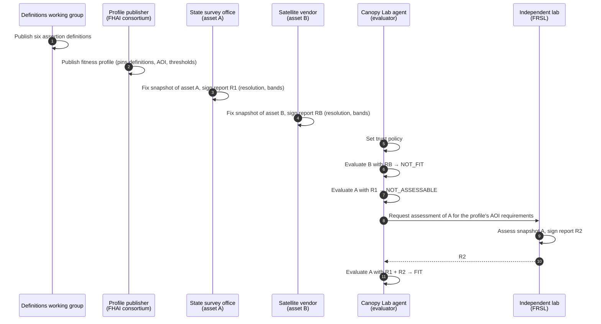
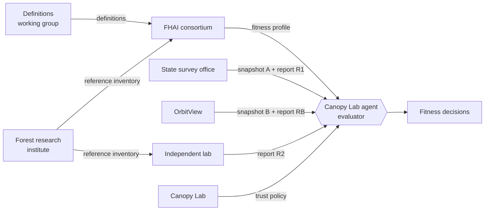
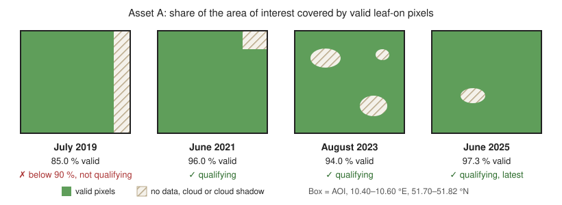
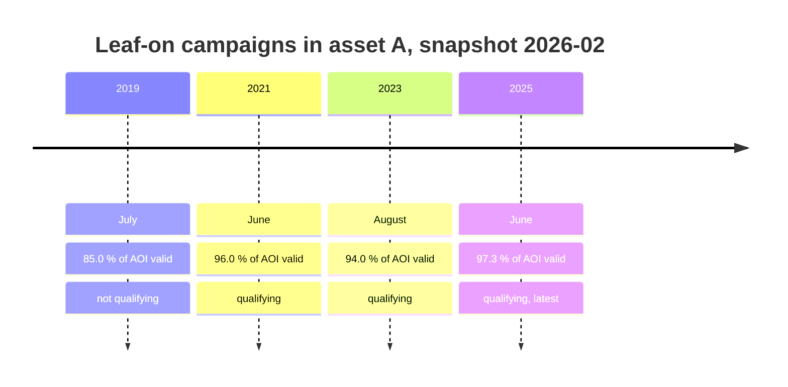
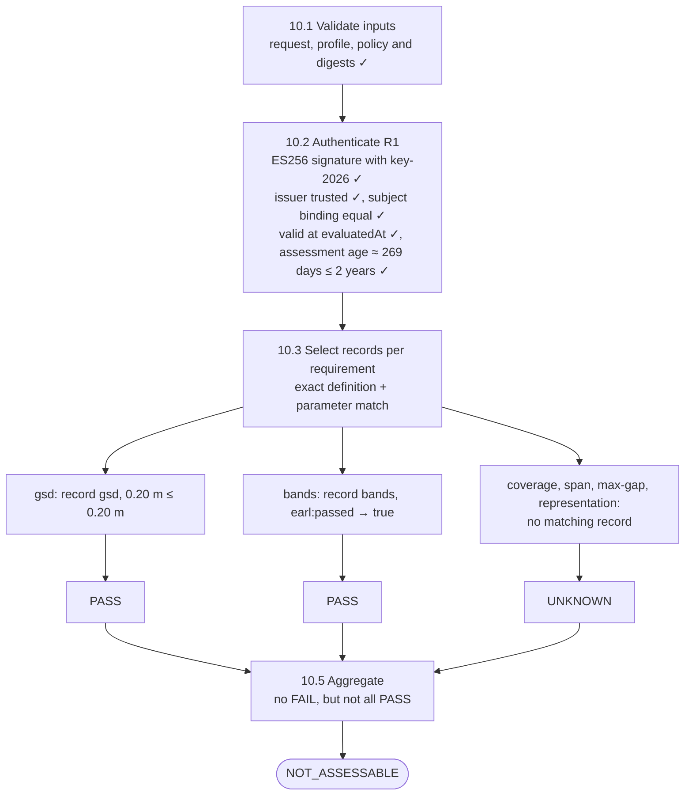
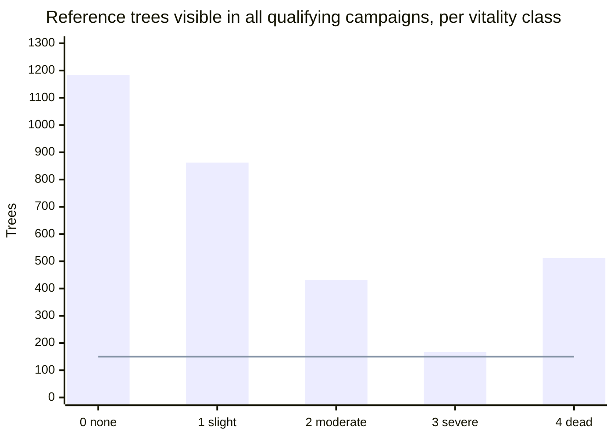

# Selecting orthoimagery for tree-vitality training data

**An end-to-end OFF example · Informative guide to [OFF 0.3 draft](../open-fitness-framework-spec.md)**

> [!NOTE]
> This guide is informative. It explains the specification by example and does not add requirements. The setting is inspired by real practice: colour-infrared aerial orthophotos from a German state survey, forest condition surveys and drought-related spruce dieback in the Harz mountains. All organisations, URLs, identifiers, digests, keys and numbers are invented for illustration, and no real report is claimed.

## Contents

- [The story in one minute](#the-story-in-one-minute)
- [1 The setting and the cast](#1-the-setting-and-the-cast)
- [2 Step 1: Domain experts publish assertion definitions](#2-step-1-domain-experts-publish-assertion-definitions)
- [3 Step 2: The consortium publishes a fitness profile](#3-step-2-the-consortium-publishes-a-fitness-profile)
- [4 Step 3: Canopy Lab sets its trust policy](#4-step-3-canopy-lab-sets-its-trust-policy)
- [5 Step 4: Data publishers fix snapshots](#5-step-4-data-publishers-fix-snapshots)
- [6 Step 5: Providers issue reports](#6-step-5-providers-issue-reports)
- [7 Step 6: The agent's first evaluation](#7-step-6-the-agents-first-evaluation)
- [8 Step 7: Requesting the missing evidence](#8-step-7-requesting-the-missing-evidence)
- [9 Step 8: Re-evaluation](#9-step-8-re-evaluation)
- [10 Step 9: Using the data, and what happens next](#10-step-9-using-the-data-and-what-happens-next)
- [11 What this example shows](#11-what-this-example-shows)

## The story in one minute

A research group wants to train a machine-learning model that recognises the vitality of trees from aerial imagery. Their software agent has to find imagery that is good enough for this purpose. It looks at two candidates for a forest area in the western Harz:

- **Asset A**, a series of colour-infrared aerial orthophotos with 20 cm pixels, flown by the state survey office every two years.
- **Asset B**, a commercial satellite mosaic with 50 cm pixels and only red, green and blue bands.

The requirements come from a published fitness profile: enough coverage of the area, fine enough pixels, a near-infrared band, a long enough time series without large gaps, and enough examples of every vitality class. The agent collects signed reports about each asset and evaluates them.

- **Asset B** is **NOT_FIT**: its own vendor's report shows that the pixels are too coarse and the near-infrared band is missing.
- **Asset A** is first **NOT_ASSESSABLE**: the survey office's report confirms resolution and bands, but nobody has assessed the area of interest yet. The agent asks an independent lab for an assessment. With the lab's report, asset A is **FIT**.



## 1 The setting and the cast

The area of interest (AOI) is a 0.20° × 0.12° box in the western Harz, from 10.40 °E to 10.60 °E and from 51.70 °N to 51.82 °N, about 184 km² of mostly spruce and beech forest. Since the drought years from 2018 onwards, large spruce stands there have died back, so the area contains trees in every vitality state from healthy to dead.

OFF separates roles even when one organisation performs several of them ([Section 3](../open-fitness-framework-spec.md#3-architecture-and-responsibilities)). In this example:

| Actor | Fictional organisation | OFF role(s) | What it produces |
| --- | --- | --- | --- |
| Definitions working group | EO Fitness Working Group (`defs.eo-fitness.example`) | Definition publisher | Six assertion definitions |
| Profile publisher | Forest Health AI consortium, FHAI (`fhai.example`) | Profile publisher | Fitness profile for tree-vitality training imagery |
| Reference data provider | Forest research institute, FRI (`fri.example`) | Supplier of reference data | Pinned inventory of field-assessed reference trees |
| Asset A publisher | State survey office (`geodata.example`) | Asset publisher, assessor, report issuer | Orthophoto snapshot, report R1 |
| Asset B publisher | OrbitView satellite vendor (`orbitview.example`) | Asset publisher, assessor, report issuer | Satellite mosaic snapshot, report RB |
| Independent lab | Forest Remote Sensing Lab, FRSL (`frsl.example`) | Assessor, report issuer | Report R2 |
| Data consumer | Canopy Lab (`canopy.example`) | Trust policy owner; runs the agent, which acts as evaluator | Trust policy, evaluation requests, decisions |



## 2 Step 1: Domain experts publish assertion definitions

OFF itself defines no quality metrics. It defines how metrics and tests are identified, parameterised and compared ([Section 7](../open-fitness-framework-spec.md#7-assertion-definitions-and-domain-semantics)). Domain communities publish the actual definitions. Here, a working group of remote-sensing experts publishes six of them as `AssertionDefinition` documents ([Section 7.1](../open-fitness-framework-spec.md#71-definition-contract)).

Each definition is pinned by URI and SHA-256 digest. Profiles and reports refer to exactly these bytes, so nobody can quietly change what "coverage" means after reports have been signed.

| Short name | Kind | Value | What it means |
| --- | --- | --- | --- |
| `aoi-valid-coverage/1.0` | measurement | decimal, unitless, 0–1 | Share of the AOI covered by valid pixels in the latest campaign acquired in the leaf-on window of the given years. |
| `ground-sample-distance/1.0` | measurement | decimal, metres | Largest nominal ground sample distance (pixel size on the ground) of any raster in the snapshot. |
| `band-composition/1.0` | test | passed or failed | Every raster provides the listed spectral bands, with near-infrared meaning a band centred between 780 and 900 nm. |
| `qualifying-campaign-span/1.0` | measurement | integer, years | Years between the first and the last *qualifying* campaign. |
| `qualifying-campaign-max-gap/1.0` | measurement | integer, years | Largest number of years between two consecutive qualifying campaigns. |
| `vitality-class-representation/1.0` | measurement | integer, count | Smallest number of reference trees, over all five vitality classes, that are visible in valid pixels of every qualifying campaign. |

Three ideas are shared by several definitions:

- **Valid pixel.** A pixel that is not no-data and is not flagged as cloud, cloud shadow or haze by the cloud-masking procedure that the assessment method declares.
- **Leaf-on campaign.** An acquisition campaign whose images were all taken within the `leafOnWindow` (here 1 June to 31 August) of a year in the `years` range. Tree vitality is only visible when trees carry leaves or needles.
- **Qualifying campaign.** A leaf-on campaign in which valid pixels cover at least `minCampaignCoverage` of the AOI.

Splitting the time-series requirement into *span* and *maximum gap* keeps each measurement a single value, which is what OFF compares. Together they say "the series is long enough" and "it has no big holes".

### The representation definition in full

The most domain-specific definition counts reference trees per vitality class. It uses the five crown-defoliation classes of European forest condition surveys: 0 none (up to 10 % needle or leaf loss), 1 slight (over 10–25 %), 2 moderate (over 25–60 %), 3 severe (over 60 %, still alive) and 4 dead. The class scheme is a pinned dependency of the definition. The reference inventory is a parameter, so a profile can choose which inventory release to use.

An OFF measurement carries exactly one value, so the definition reports the *minimum* count over the classes. The per-class counts are required details: they are signed with the record and explain the value, but the evaluator does not compare them.

```json
{
  "specVersion": "0.3-draft",
  "type": "AssertionDefinition",
  "id": "https://defs.eo-fitness.example/vitality-class-representation/1.0",
  "version": "1.0.0",
  "kind": "measurement",
  "name": "Representation of tree-vitality classes in qualifying leaf-on imagery",
  "assessedProperty": "How many field-assessed reference trees of each vitality class are visible in valid pixels of every qualifying leaf-on campaign over the area of interest.",
  "parameterSchema": {
    "type": "object",
    "required": ["aoi", "years", "leafOnWindow", "minCampaignCoverage", "referenceInventory"],
    "additionalProperties": false,
    "properties": {
      "aoi": {
        "type": "object",
        "required": ["bbox", "crs"],
        "additionalProperties": false,
        "properties": {
          "bbox": { "type": "array", "items": { "type": "string" }, "minItems": 4, "maxItems": 4 },
          "crs": { "const": "http://www.opengis.net/def/crs/OGC/1.3/CRS84" }
        }
      },
      "years": {
        "type": "object",
        "required": ["from", "to"],
        "properties": { "from": { "type": "integer" }, "to": { "type": "integer" } }
      },
      "leafOnWindow": {
        "type": "object",
        "required": ["start", "end"],
        "properties": {
          "start": { "type": "string", "pattern": "^[0-1][0-9]-[0-3][0-9]$" },
          "end": { "type": "string", "pattern": "^[0-1][0-9]-[0-3][0-9]$" }
        }
      },
      "minCampaignCoverage": { "type": "string" },
      "referenceInventory": {
        "type": "object",
        "required": ["id", "digest"],
        "properties": { "id": { "type": "string" }, "digest": { "type": "object" } }
      }
    }
  },
  "interpretation": "Determine the qualifying campaigns: leaf-on campaigns in the year range whose valid pixels cover at least minCampaignCoverage of the AOI. For each vitality class, count the reference trees inside the AOI whose crown centre lies on a valid pixel in every qualifying campaign. The value is the smallest of the five counts. bbox is west, south, east, north as decimal strings in the given CRS.",
  "indeterminateCases": [
    "No qualifying campaign exists: inconclusive, no value.",
    "The reference inventory cannot be read or does not use the pinned class scheme: error, no value.",
    "The snapshot provides no information to determine acquisition dates: inconclusive, no value."
  ],
  "valueType": "integer",
  "unit": "http://qudt.org/vocab/unit/NUM",
  "range": { "minimum": "0" },
  "requiredDetails": {
    "perClass": "Object mapping each class code (\"0\" to \"4\") to its count as an integer string.",
    "qualifyingCampaigns": "Array of the qualifying campaign identifiers, in the form YYYY-MM."
  },
  "dependencies": [
    {
      "id": "https://defs.eo-fitness.example/classes/crown-defoliation-5",
      "digest": { "algorithm": "sha-256", "value": "f1be9bec85bb4a541772ea9bb49f82acaf6239f839443752f1a91547b3cc97c3" }
    }
  ],
  "dimension": "https://defs.eo-fitness.example/dimensions/representativeness"
}
```

The bounding box is given as decimal strings, because OFF only allows integer JSON numbers inside parameters ([Section 4.1](../open-fitness-framework-spec.md#41-json-representation)). This keeps parameter comparison exact: `"10.40"` and `"10.4"` are different parameters.

## 3 Step 2: The consortium publishes a fitness profile

The FHAI consortium knows what its model needs and writes it down once, as a fitness profile ([Section 5](../open-fitness-framework-spec.md#5-fitness-profiles)). Anyone training tree-vitality models for this area can reuse it.

| Requirement | Definition | Condition | Why the model needs it |
| --- | --- | --- | --- |
| `coverage` | aoi-valid-coverage | ≥ 0.95 | Training tiles must be available across the whole area in the most recent imagery. |
| `gsd` | ground-sample-distance | ≤ 0.20 m | Individual crowns must be several pixels wide. |
| `bands` | band-composition (red, green, blue, nir) | passed | Vitality shows most clearly in near-infrared reflectance. |
| `span` | qualifying-campaign-span | ≥ 4 years | The model should learn how damage develops over time. |
| `max-gap` | qualifying-campaign-max-gap | ≤ 3 years | Damage stages must not be skipped between images. |
| `representation` | vitality-class-representation | ≥ 150 trees | Every class needs enough labelled examples to train and validate. |

The AOI and the qualifying-campaign settings are **parameters** of the requirements that depend on them. Resolution and band composition are properties of the whole asset and have no AOI parameter. This is why the profile uses parameters rather than an extension E1 selection scope: a scope would apply to every requirement and would prevent whole-asset evidence from matching ([Section 5.2](../open-fitness-framework-spec.md#52-requirements)).

```json
{
  "specVersion": "0.3-draft",
  "type": "FitnessProfile",
  "id": "https://fhai.example/profiles/tree-vitality-training-harz-west",
  "version": "1.0.0",
  "name": "Orthoimagery for tree-vitality model training, western Harz",
  "purpose": {
    "id": "https://fhai.example/purposes/tree-vitality-model-training",
    "description": "Train and validate a model that classifies crown defoliation of individual trees from leaf-on aerial or satellite imagery."
  },
  "requirements": [
    {
      "id": "coverage",
      "description": "Valid pixels of the latest leaf-on campaign cover at least 95 % of the AOI.",
      "statement": {
        "definition": {
          "id": "https://defs.eo-fitness.example/aoi-valid-coverage/1.0",
          "digest": { "algorithm": "sha-256", "value": "6303fdefa3e3938299baf6ef446357df545430ee271386eee234090e172dc4e5" }
        },
        "parameters": {
          "aoi": { "bbox": ["10.40", "51.70", "10.60", "51.82"], "crs": "http://www.opengis.net/def/crs/OGC/1.3/CRS84" },
          "years": { "from": 2018, "to": 2025 },
          "leafOnWindow": { "start": "06-01", "end": "08-31" }
        }
      },
      "condition": {
        "operator": "gte",
        "expected": { "type": "decimal", "value": "0.95", "unit": "http://qudt.org/vocab/unit/UNITLESS" }
      }
    },
    {
      "id": "gsd",
      "description": "Ground sample distance of at most 20 cm.",
      "statement": {
        "definition": {
          "id": "https://defs.eo-fitness.example/ground-sample-distance/1.0",
          "digest": { "algorithm": "sha-256", "value": "d9f2615877737b079a896118976798d87f31f4eaac87b74e3b435acef95fd72e" }
        },
        "parameters": {}
      },
      "condition": {
        "operator": "lte",
        "expected": { "type": "decimal", "value": "0.20", "unit": "http://qudt.org/vocab/unit/M" }
      }
    },
    {
      "id": "bands",
      "description": "Red, green, blue and near-infrared bands in every raster.",
      "statement": {
        "definition": {
          "id": "https://defs.eo-fitness.example/band-composition/1.0",
          "digest": { "algorithm": "sha-256", "value": "1634f172c8486194ce4ed94fa2c2d0f6e9bb329328d3fb6d989107a015608b21" }
        },
        "parameters": { "bands": ["red", "green", "blue", "nir"] }
      },
      "condition": {
        "operator": "eq",
        "expected": { "type": "boolean", "value": true }
      }
    },
    {
      "id": "span",
      "description": "Qualifying campaigns span at least four years.",
      "statement": {
        "definition": {
          "id": "https://defs.eo-fitness.example/qualifying-campaign-span/1.0",
          "digest": { "algorithm": "sha-256", "value": "f7cef49236f44874039190037bcc169dcab4379705960b56168323cbb0fa7cb8" }
        },
        "parameters": {
          "aoi": { "bbox": ["10.40", "51.70", "10.60", "51.82"], "crs": "http://www.opengis.net/def/crs/OGC/1.3/CRS84" },
          "years": { "from": 2018, "to": 2025 },
          "leafOnWindow": { "start": "06-01", "end": "08-31" },
          "minCampaignCoverage": "0.90"
        }
      },
      "condition": {
        "operator": "gte",
        "expected": { "type": "integer", "value": "4", "unit": "http://qudt.org/vocab/unit/YR" }
      }
    },
    {
      "id": "max-gap",
      "description": "No more than three years between consecutive qualifying campaigns.",
      "statement": {
        "definition": {
          "id": "https://defs.eo-fitness.example/qualifying-campaign-max-gap/1.0",
          "digest": { "algorithm": "sha-256", "value": "0ec20b32ba1bc4bfbcc1214fe409fdfa8fb7e6da3df942f3c2e81fd6840e9418" }
        },
        "parameters": {
          "aoi": { "bbox": ["10.40", "51.70", "10.60", "51.82"], "crs": "http://www.opengis.net/def/crs/OGC/1.3/CRS84" },
          "years": { "from": 2018, "to": 2025 },
          "leafOnWindow": { "start": "06-01", "end": "08-31" },
          "minCampaignCoverage": "0.90"
        }
      },
      "condition": {
        "operator": "lte",
        "expected": { "type": "integer", "value": "3", "unit": "http://qudt.org/vocab/unit/YR" }
      }
    },
    {
      "id": "representation",
      "description": "At least 150 visible reference trees in every vitality class.",
      "statement": {
        "definition": {
          "id": "https://defs.eo-fitness.example/vitality-class-representation/1.0",
          "digest": { "algorithm": "sha-256", "value": "f6c4e2bb98a440c2d7407a073b148b0a648f1cc941cb97f89b011ae383d370c4" }
        },
        "parameters": {
          "aoi": { "bbox": ["10.40", "51.70", "10.60", "51.82"], "crs": "http://www.opengis.net/def/crs/OGC/1.3/CRS84" },
          "years": { "from": 2018, "to": 2025 },
          "leafOnWindow": { "start": "06-01", "end": "08-31" },
          "minCampaignCoverage": "0.90",
          "referenceInventory": {
            "id": "https://fri.example/inventories/harz-vitality-reference/2025",
            "digest": { "algorithm": "sha-256", "value": "ed60a4fb125fc63cc7dca81e48d61ec89398009e9b462a01773fe8b11eea51dd" }
          }
        }
      },
      "condition": {
        "operator": "gte",
        "expected": { "type": "integer", "value": "150", "unit": "http://qudt.org/vocab/unit/NUM" }
      }
    }
  ]
}
```

Three things in this profile matter later:

- **Every requirement is mandatory.** This is a core profile, so FIT needs all six to PASS ([Section 5.4](../open-fitness-framework-spec.md#54-core-conjunction-rule)).
- **The thresholds are the consortium's choice.** Another group could reuse the same definitions and the same reports with, say, a 10 cm resolution limit and reach a different decision.
- **The reference inventory is pinned, not published.** Field plot locations from forest surveys are usually confidential. The profile only pins the digest of the inventory release. Whoever assesses representation needs authorised access to it; the evaluator does not.

## 4 Step 3: Canopy Lab sets its trust policy

A profile says what is needed, but not whose word to take for it. That is a local decision of the data consumer ([Section 8.2](../open-fitness-framework-spec.md#82-local-trust-policy)). Canopy Lab trusts:

| Issuer | Trusted for | Reasoning |
| --- | --- | --- |
| State survey office | ground-sample-distance, band-composition | It produces the orthophotos and knows their sensor and processing. |
| OrbitView | ground-sample-distance, band-composition | The same, for its own satellite product. |
| Forest Remote Sensing Lab | aoi-valid-coverage, qualifying-campaign-span, qualifying-campaign-max-gap, vitality-class-representation | Independent, has authorised access to the reference inventory, and has published its methods. |

Canopy Lab does **not** trust the data publishers to assess area coverage or class representation of their own products for this purpose. It also limits assessment age to two years. The policy pins one ES256 key per issuer.

```json
{
  "specVersion": "0.3-draft",
  "type": "TrustPolicy",
  "id": "https://canopy.example/policies/imagery",
  "version": "4",
  "trustedIssuers": [
    {
      "issuer": "https://geodata.example/off/issuer",
      "keys": [
        {
          "id": "https://geodata.example/off/issuer#key-2026",
          "algorithm": "ES256",
          "key": { "kty": "EC", "crv": "P-256", "x": "A_SWdkeg36rNbgP3EetkcMZrDjblaTK2JF6ZbIWwMk0", "y": "nS0MwRbWcg8_-GbyClay_1qVWb1JxP1C9edHFW9EYKs" }
        }
      ],
      "allowedDefinitions": [
        { "id": "https://defs.eo-fitness.example/ground-sample-distance/1.0", "digest": { "algorithm": "sha-256", "value": "d9f2615877737b079a896118976798d87f31f4eaac87b74e3b435acef95fd72e" } },
        { "id": "https://defs.eo-fitness.example/band-composition/1.0", "digest": { "algorithm": "sha-256", "value": "1634f172c8486194ce4ed94fa2c2d0f6e9bb329328d3fb6d989107a015608b21" } }
      ]
    },
    {
      "issuer": "https://orbitview.example/issuer",
      "keys": [
        {
          "id": "https://orbitview.example/issuer#k1",
          "algorithm": "ES256",
          "key": { "kty": "EC", "crv": "P-256", "x": "p6QFo_BjUC1SeVoPEzS93prCUY-fidbWZH9ZS6wSGoM", "y": "UuGiNBqdRYi-Th0RdNQ7JzzVjKmwLGZAPx1jEgrkElQ" }
        }
      ],
      "allowedDefinitions": [
        { "id": "https://defs.eo-fitness.example/ground-sample-distance/1.0", "digest": { "algorithm": "sha-256", "value": "d9f2615877737b079a896118976798d87f31f4eaac87b74e3b435acef95fd72e" } },
        { "id": "https://defs.eo-fitness.example/band-composition/1.0", "digest": { "algorithm": "sha-256", "value": "1634f172c8486194ce4ed94fa2c2d0f6e9bb329328d3fb6d989107a015608b21" } }
      ]
    },
    {
      "issuer": "https://frsl.example/issuer",
      "keys": [
        {
          "id": "https://frsl.example/issuer#2026-a",
          "algorithm": "ES256",
          "key": { "kty": "EC", "crv": "P-256", "x": "GhQI5f7fJFrTSvAtif3mey3Fg_IzKa6RdHKrbdARb-s", "y": "FHEbgZimWMRYyCTvo9z1eb2C2-y-EybMGIxEnfIifow" }
        }
      ],
      "allowedDefinitions": [
        { "id": "https://defs.eo-fitness.example/aoi-valid-coverage/1.0", "digest": { "algorithm": "sha-256", "value": "6303fdefa3e3938299baf6ef446357df545430ee271386eee234090e172dc4e5" } },
        { "id": "https://defs.eo-fitness.example/qualifying-campaign-span/1.0", "digest": { "algorithm": "sha-256", "value": "f7cef49236f44874039190037bcc169dcab4379705960b56168323cbb0fa7cb8" } },
        { "id": "https://defs.eo-fitness.example/qualifying-campaign-max-gap/1.0", "digest": { "algorithm": "sha-256", "value": "0ec20b32ba1bc4bfbcc1214fe409fdfa8fb7e6da3df942f3c2e81fd6840e9418" } },
        { "id": "https://defs.eo-fitness.example/vitality-class-representation/1.0", "digest": { "algorithm": "sha-256", "value": "f6c4e2bb98a440c2d7407a073b148b0a648f1cc941cb97f89b011ae383d370c4" } }
      ]
    }
  ],
  "maxAssessmentAgeSeconds": 63072000
}
```

## 5 Step 4: Data publishers fix snapshots

An OFF report is always about one immutable snapshot of an asset ([Section 4.4](../open-fitness-framework-spec.md#44-data-asset-binding)). An orthophoto series grows with every flight campaign, so the survey office publishes numbered snapshots. Snapshot `2026-02` contains all four leaf-on campaigns flown over the area since 2018, as cloud-optimised GeoTIFF tiles. A manifest lists every tile with its own digest, and the snapshot's digest is the digest of that manifest.

| | Asset A | Asset B |
| --- | --- | --- |
| Asset | `https://geodata.example/dop20-rgbi/harz` | `https://orbitview.example/products/harz-mosaic` |
| Representation | `.../harz/cog` (Cloud-optimised GeoTIFF tiles) | `.../harz-mosaic/geotiff-3band` |
| Snapshot | `.../harz/snapshots/2026-02` | `.../harz-mosaic/snapshots/2024-07-v1` |
| Digest kind | `manifest` (four campaigns, 1,312 tiles) | `content` (one mosaic file) |
| Content | Aerial CIR orthophotos, 20 cm, bands R, G, B, NIR; campaigns July 2019, June 2021, August 2023, June 2025 | Satellite mosaic, 50 cm, bands R, G, B; acquired July 2024 |

For asset A, the campaign history decides the time-series requirements. In July 2019, weather cut the flight short, and only 85 % of the AOI has valid pixels. That campaign therefore does not qualify. The later three do.





From this, span = 2025 − 2021 = **4 years** and maximum gap = **2 years**. Had the 2019 campaign qualified, the span would have been 6; had the 2023 campaign failed instead, the gap would have been 4 and the `max-gap` requirement would fail.

## 6 Step 5: Providers issue reports

### Report R1: the survey office assesses its own product

After processing the 2025 campaign, the survey office's quality assurance checks every tile of snapshot `2026-02`. It records two things it can assess for the whole asset, independent of anyone's AOI: the ground sample distance and the band composition. It signs the result as report R1. Below is the full credential that forms the JWS payload ([Section 6.1](../open-fitness-framework-spec.md#61-credential-structure)); on the wire it is signed with the survey office's `key-2026` ([Section 8.1](../open-fitness-framework-spec.md#81-baseline-signature-binding)).

```json
{
  "@context": [
    "https://www.w3.org/ns/credentials/v2",
    {
      "OffFitnessReportCredential": "https://www.open-fitness-framework.org/spec/0.3/FitnessReportCredential",
      "OffAssetSnapshot": "https://www.open-fitness-framework.org/spec/0.3/AssetSnapshot",
      "offReport": { "@id": "https://www.open-fitness-framework.org/spec/0.3/report", "@type": "@json" }
    }
  ],
  "id": "https://geodata.example/off/reports/dop20-harz-2026-02-qa",
  "type": ["VerifiableCredential", "OffFitnessReportCredential"],
  "issuer": "https://geodata.example/off/issuer",
  "validFrom": "2026-02-23T08:00:00Z",
  "validUntil": "2028-02-23T08:00:00Z",
  "credentialSubject": {
    "id": "https://geodata.example/dop20-rgbi/harz/snapshots/2026-02",
    "type": "OffAssetSnapshot",
    "offReport": {
      "specVersion": "0.3-draft",
      "subject": {
        "assetId": "https://geodata.example/dop20-rgbi/harz",
        "representationId": "https://geodata.example/dop20-rgbi/harz/cog",
        "snapshotId": "https://geodata.example/dop20-rgbi/harz/snapshots/2026-02",
        "digestKind": "manifest",
        "digest": { "algorithm": "sha-256", "value": "d52ed0df78a40aeff05eb63d31d7b5da41d178b6561557554ffe0f6c96edf532" }
      },
      "scope": { "kind": "whole" },
      "coverage": { "kind": "complete" },
      "issuedAt": "2026-02-23T08:00:00Z",
      "assessment": {
        "id": "https://geodata.example/qa/runs/2026-0219",
        "operator": "https://geodata.example/off/issuer",
        "mode": "earl:automatic",
        "method": {
          "id": "https://geodata.example/qa/methods/dop-delivery-check/5",
          "digest": { "algorithm": "sha-256", "value": "c267aae2da366bf42c4a7b2bcc6ea87d75a2828ebcdf5d5f11aaa2d393901bc8" }
        },
        "endedAt": "2026-02-20T17:12:00Z",
        "tools": [{ "id": "https://geodata.example/tools/dop-qa", "version": "5.1.0" }]
      },
      "assertions": [
        {
          "id": "gsd",
          "kind": "measurement",
          "definition": {
            "id": "https://defs.eo-fitness.example/ground-sample-distance/1.0",
            "digest": { "algorithm": "sha-256", "value": "d9f2615877737b079a896118976798d87f31f4eaac87b74e3b435acef95fd72e" }
          },
          "parameters": {},
          "executionStatus": "completed",
          "value": { "type": "decimal", "value": "0.20", "unit": "http://qudt.org/vocab/unit/M" },
          "details": { "rasterCount": "1312" },
          "evidence": ["qa-log"],
          "limitations": []
        },
        {
          "id": "bands",
          "kind": "test",
          "definition": {
            "id": "https://defs.eo-fitness.example/band-composition/1.0",
            "digest": { "algorithm": "sha-256", "value": "1634f172c8486194ce4ed94fa2c2d0f6e9bb329328d3fb6d989107a015608b21" }
          },
          "parameters": { "bands": ["red", "green", "blue", "nir"] },
          "result": { "outcome": "earl:passed" },
          "evidence": ["qa-log"],
          "limitations": []
        }
      ],
      "evidence": [
        {
          "id": "qa-log",
          "resource": {
            "id": "https://geodata.example/qa/runs/2026-0219/log.json",
            "digest": { "algorithm": "sha-256", "value": "020f59a6a910846bca69e272e8d13025f02f0ea5406a56c35cc39a01857834fc" }
          },
          "href": "https://geodata.example/qa/runs/2026-0219/log.json",
          "mediaType": "application/json",
          "role": "log"
        }
      ]
    }
  }
}
```

Note what R1 does **not** say. It has no record about the AOI, because the survey office cannot know which area a future user cares about. It also does not say the imagery is "fit": that depends on the purpose.

### Report RB: the satellite vendor assesses its mosaic

OrbitView issues report RB about its mosaic in the same way, using the same two definitions. It is signed with OrbitView's key; the essentials of its body are:

| Field | Value |
| --- | --- |
| Report id | `https://orbitview.example/off/reports/harz-mosaic-2024-07-v1` |
| Subject | snapshot `https://orbitview.example/products/harz-mosaic/snapshots/2024-07-v1`, `digestKind` `content`, digest `b2788ae3…dd1e` |
| Assessment | `earl:automatic`, ended 2026-08-28T10:00:00Z; issued 2026-09-01T09:00:00Z |
| Record `gsd` | measurement, completed, value `0.50` m |
| Record `bands` | test for red, green, blue, nir: `earl:failed`; details list the bands present as red, green, blue |

The vendor reports honestly that its product lacks a near-infrared band. A failed test is still useful evidence: it lets an evaluator reach NOT_FIT instead of NOT_ASSESSABLE.

## 7 Step 6: The agent's first evaluation

Canopy Lab's agent finds both assets in a data catalogue. The catalogue entries link to the reports. Discovery is outside the OFF core ([Section 12](../open-fitness-framework-spec.md#12-discovery-and-lifecycle)), so the agent downloads what it found and pins it in an evaluation request ([Section 9](../open-fitness-framework-spec.md#9-evaluation-requests)). The request for asset A:

```json
{
  "specVersion": "0.3-draft",
  "type": "EvaluationRequest",
  "id": "https://canopy.example/evaluations/2026-11-16-a",
  "subject": {
    "assetId": "https://geodata.example/dop20-rgbi/harz",
    "representationId": "https://geodata.example/dop20-rgbi/harz/cog",
    "snapshotId": "https://geodata.example/dop20-rgbi/harz/snapshots/2026-02",
    "digestKind": "manifest",
    "digest": { "algorithm": "sha-256", "value": "d52ed0df78a40aeff05eb63d31d7b5da41d178b6561557554ffe0f6c96edf532" }
  },
  "scope": { "kind": "whole" },
  "purpose": "https://fhai.example/purposes/tree-vitality-model-training",
  "profile": {
    "id": "https://fhai.example/profiles/tree-vitality-training-harz-west/1.0.0.json",
    "digest": { "algorithm": "sha-256", "value": "a4298340936c5564080ca9fe65d59a22cd728de94cd7fe27aadff0a8e0342855" }
  },
  "trustPolicy": {
    "id": "https://canopy.example/policies/imagery/4.json",
    "digest": { "algorithm": "sha-256", "value": "2847912588fa59ab3b62fea52b07323d03bb263ac2d67dd06d8716ba82c0fff0" }
  },
  "evaluatedAt": "2026-11-16T08:00:00Z",
  "reportResources": [
    {
      "id": "https://geodata.example/off/reports/dop20-harz-2026-02-qa.jwt",
      "digest": { "algorithm": "sha-256", "value": "737b8a1f74872c604331f5a0cf9532fcc85f2dc2e9c74c4cf61b35c82d3e191c" }
    }
  ]
}
```

The request for asset B (`https://canopy.example/evaluations/2026-11-16-b`) differs only in its `subject`, which is the mosaic snapshot binding, and its `reportResources`, which pin report RB. Profile, trust policy and evaluation time are the same.

### What the evaluator does

The evaluator follows the deterministic procedure of [Section 10](../open-fitness-framework-spec.md#10-deterministic-evaluation-procedure). For asset A with report R1:



Two details are worth pointing out:

- **`gsd` passes at exactly the threshold.** OFF compares decimal strings with exact arithmetic ([Section 4.2](../open-fitness-framework-spec.md#42-values-and-timestamps)), so 0.20 ≤ 0.20 holds, and a measured 0.2000001 would fail.
- **UNKNOWN is not FAIL.** Nobody has shown that asset A covers too little of the AOI; nobody has measured it at all. OFF keeps those two situations apart.

### Decision for asset A: NOT_ASSESSABLE

```json
{
  "specVersion": "0.3-draft",
  "type": "FitnessDecision",
  "id": "https://canopy.example/decisions/2026-11-16-a",
  "request": {
    "id": "https://canopy.example/evaluations/2026-11-16-a.json",
    "digest": { "algorithm": "sha-256", "value": "762cc949b4a738502ad1b0643561418675b4ddee8b7c87e497e30bf394b67b93" }
  },
  "evaluator": { "id": "https://canopy.example/agent/off-evaluator", "version": "0.3.2" },
  "decidedAt": "2026-11-16T08:00:04Z",
  "evaluationStatus": "completed",
  "result": "NOT_ASSESSABLE",
  "requirementResults": [
    {
      "id": "coverage",
      "outcome": "UNKNOWN",
      "reasons": ["NO_ADMISSIBLE_EVIDENCE"],
      "acceptedTrace": [],
      "excludedTrace": []
    },
    {
      "id": "gsd",
      "outcome": "PASS",
      "reasons": ["PREDICATE_SATISFIED"],
      "acceptedTrace": [
        { "report": "https://geodata.example/off/reports/dop20-harz-2026-02-qa", "assertion": "gsd", "predicate": "PASS" }
      ],
      "excludedTrace": []
    },
    {
      "id": "bands",
      "outcome": "PASS",
      "reasons": ["PREDICATE_SATISFIED"],
      "acceptedTrace": [
        { "report": "https://geodata.example/off/reports/dop20-harz-2026-02-qa", "assertion": "bands", "predicate": "PASS" }
      ],
      "excludedTrace": []
    },
    {
      "id": "span",
      "outcome": "UNKNOWN",
      "reasons": ["NO_ADMISSIBLE_EVIDENCE"],
      "acceptedTrace": [],
      "excludedTrace": []
    },
    {
      "id": "max-gap",
      "outcome": "UNKNOWN",
      "reasons": ["NO_ADMISSIBLE_EVIDENCE"],
      "acceptedTrace": [],
      "excludedTrace": []
    },
    {
      "id": "representation",
      "outcome": "UNKNOWN",
      "reasons": ["NO_ADMISSIBLE_EVIDENCE"],
      "acceptedTrace": [],
      "excludedTrace": []
    }
  ],
  "errors": [],
  "limitations": [
    "Submitted-only evidence set; no discovery was performed by the evaluator.",
    "No revocation channel was checked."
  ]
}
```

### Decision for asset B: NOT_FIT

For asset B, report RB authenticates and is admitted. Its `gsd` record (0.50 m) violates `≤ 0.20`, and its `bands` record (`earl:failed`, so `false`) violates `eq true`. One FAIL is enough for NOT_FIT, even though four requirements remain UNKNOWN ([Section 10.5](../open-fitness-framework-spec.md#105-aggregate-the-decision)). The agent drops asset B and does not need to ask anyone for more evidence.

```json
{
  "specVersion": "0.3-draft",
  "type": "FitnessDecision",
  "id": "https://canopy.example/decisions/2026-11-16-b",
  "request": {
    "id": "https://canopy.example/evaluations/2026-11-16-b.json",
    "digest": { "algorithm": "sha-256", "value": "6badd4a5382d382b82b2562035d6465116511de905a81e948e84fbe7af427a97" }
  },
  "evaluator": { "id": "https://canopy.example/agent/off-evaluator", "version": "0.3.2" },
  "decidedAt": "2026-11-16T08:05:02Z",
  "evaluationStatus": "completed",
  "result": "NOT_FIT",
  "requirementResults": [
    { "id": "coverage", "outcome": "UNKNOWN", "reasons": ["NO_ADMISSIBLE_EVIDENCE"], "acceptedTrace": [], "excludedTrace": [] },
    {
      "id": "gsd",
      "outcome": "FAIL",
      "reasons": ["PREDICATE_VIOLATED"],
      "acceptedTrace": [
        { "report": "https://orbitview.example/off/reports/harz-mosaic-2024-07-v1", "assertion": "gsd", "predicate": "FAIL" }
      ],
      "excludedTrace": []
    },
    {
      "id": "bands",
      "outcome": "FAIL",
      "reasons": ["PREDICATE_VIOLATED"],
      "acceptedTrace": [
        { "report": "https://orbitview.example/off/reports/harz-mosaic-2024-07-v1", "assertion": "bands", "predicate": "FAIL" }
      ],
      "excludedTrace": []
    },
    { "id": "span", "outcome": "UNKNOWN", "reasons": ["NO_ADMISSIBLE_EVIDENCE"], "acceptedTrace": [], "excludedTrace": [] },
    { "id": "max-gap", "outcome": "UNKNOWN", "reasons": ["NO_ADMISSIBLE_EVIDENCE"], "acceptedTrace": [], "excludedTrace": [] },
    { "id": "representation", "outcome": "UNKNOWN", "reasons": ["NO_ADMISSIBLE_EVIDENCE"], "acceptedTrace": [], "excludedTrace": [] }
  ],
  "errors": [],
  "limitations": [
    "Submitted-only evidence set; no discovery was performed by the evaluator.",
    "No revocation channel was checked."
  ]
}
```

## 8 Step 7: Requesting the missing evidence

Asset A is still a candidate. The decision tells the agent exactly what is missing: evidence for `coverage`, `span`, `max-gap` and `representation`. Canopy Lab's policy trusts only the Forest Remote Sensing Lab for those, so the agent sends the lab an assessment request. How that happens (an e-mail, a web form, an API) is outside OFF. What matters is what the request contains:

- the asset snapshot binding of asset A;
- the four requirement `statement`s from the profile, copied verbatim.

The lab must copy the statements exactly, because the evaluator matches definition and parameters with exact JSON equality ([Section 4.1](../open-fitness-framework-spec.md#41-json-representation)). A record with `"minCampaignCoverage": "0.9"` instead of `"0.90"` would not match the profile. This is the price of AOI-specific parameters: the evidence is produced for one profile and is rarely reusable by others ([Section 5.2](../open-fitness-framework-spec.md#52-requirements)).

The lab downloads snapshot `2026-02`, verifies its manifest digest, applies its cloud mask, overlays the reference inventory (to which it has authorised access) and signs report R2. The essential part is the report body:

```json
{
  "specVersion": "0.3-draft",
  "subject": {
    "assetId": "https://geodata.example/dop20-rgbi/harz",
    "representationId": "https://geodata.example/dop20-rgbi/harz/cog",
    "snapshotId": "https://geodata.example/dop20-rgbi/harz/snapshots/2026-02",
    "digestKind": "manifest",
    "digest": { "algorithm": "sha-256", "value": "d52ed0df78a40aeff05eb63d31d7b5da41d178b6561557554ffe0f6c96edf532" }
  },
  "scope": { "kind": "whole" },
  "coverage": { "kind": "complete" },
  "issuedAt": "2026-11-25T09:00:00Z",
  "assessment": {
    "id": "https://frsl.example/assessments/2026-117",
    "operator": "https://frsl.example/issuer",
    "mode": "earl:semiAuto",
    "method": {
      "id": "https://frsl.example/methods/canopy-visibility/2",
      "digest": { "algorithm": "sha-256", "value": "de3c4bfacc13c5df710cc6166097538bca9bdfb9a86fb06fd68cdbe2aa1fa52e" }
    },
    "startedAt": "2026-11-19T08:30:00Z",
    "endedAt": "2026-11-24T16:40:00Z",
    "tools": [
      { "id": "https://frsl.example/tools/canopy-sampler", "version": "2.3.0" },
      { "id": "https://gdal.org", "version": "3.10.1" }
    ]
  },
  "assertions": [
    {
      "id": "coverage",
      "kind": "measurement",
      "definition": {
        "id": "https://defs.eo-fitness.example/aoi-valid-coverage/1.0",
        "digest": { "algorithm": "sha-256", "value": "6303fdefa3e3938299baf6ef446357df545430ee271386eee234090e172dc4e5" }
      },
      "parameters": {
        "aoi": { "bbox": ["10.40", "51.70", "10.60", "51.82"], "crs": "http://www.opengis.net/def/crs/OGC/1.3/CRS84" },
        "years": { "from": 2018, "to": 2025 },
        "leafOnWindow": { "start": "06-01", "end": "08-31" }
      },
      "executionStatus": "completed",
      "value": { "type": "decimal", "value": "0.973", "unit": "http://qudt.org/vocab/unit/UNITLESS" },
      "details": { "campaign": "2025-06", "aoiAreaKm2": "183.8", "validAreaKm2": "178.8" },
      "evidence": ["summary"],
      "limitations": []
    },
    {
      "id": "span",
      "kind": "measurement",
      "definition": {
        "id": "https://defs.eo-fitness.example/qualifying-campaign-span/1.0",
        "digest": { "algorithm": "sha-256", "value": "f7cef49236f44874039190037bcc169dcab4379705960b56168323cbb0fa7cb8" }
      },
      "parameters": {
        "aoi": { "bbox": ["10.40", "51.70", "10.60", "51.82"], "crs": "http://www.opengis.net/def/crs/OGC/1.3/CRS84" },
        "years": { "from": 2018, "to": 2025 },
        "leafOnWindow": { "start": "06-01", "end": "08-31" },
        "minCampaignCoverage": "0.90"
      },
      "executionStatus": "completed",
      "value": { "type": "integer", "value": "4", "unit": "http://qudt.org/vocab/unit/YR" },
      "details": { "qualifyingCampaigns": ["2021-06", "2023-08", "2025-06"], "rejectedCampaigns": ["2019-07"] },
      "evidence": ["summary"],
      "limitations": []
    },
    {
      "id": "maxGap",
      "kind": "measurement",
      "definition": {
        "id": "https://defs.eo-fitness.example/qualifying-campaign-max-gap/1.0",
        "digest": { "algorithm": "sha-256", "value": "0ec20b32ba1bc4bfbcc1214fe409fdfa8fb7e6da3df942f3c2e81fd6840e9418" }
      },
      "parameters": {
        "aoi": { "bbox": ["10.40", "51.70", "10.60", "51.82"], "crs": "http://www.opengis.net/def/crs/OGC/1.3/CRS84" },
        "years": { "from": 2018, "to": 2025 },
        "leafOnWindow": { "start": "06-01", "end": "08-31" },
        "minCampaignCoverage": "0.90"
      },
      "executionStatus": "completed",
      "value": { "type": "integer", "value": "2", "unit": "http://qudt.org/vocab/unit/YR" },
      "details": { "qualifyingCampaigns": ["2021-06", "2023-08", "2025-06"] },
      "evidence": ["summary"],
      "limitations": []
    },
    {
      "id": "representation",
      "kind": "measurement",
      "definition": {
        "id": "https://defs.eo-fitness.example/vitality-class-representation/1.0",
        "digest": { "algorithm": "sha-256", "value": "f6c4e2bb98a440c2d7407a073b148b0a648f1cc941cb97f89b011ae383d370c4" }
      },
      "parameters": {
        "aoi": { "bbox": ["10.40", "51.70", "10.60", "51.82"], "crs": "http://www.opengis.net/def/crs/OGC/1.3/CRS84" },
        "years": { "from": 2018, "to": 2025 },
        "leafOnWindow": { "start": "06-01", "end": "08-31" },
        "minCampaignCoverage": "0.90",
        "referenceInventory": {
          "id": "https://fri.example/inventories/harz-vitality-reference/2025",
          "digest": { "algorithm": "sha-256", "value": "ed60a4fb125fc63cc7dca81e48d61ec89398009e9b462a01773fe8b11eea51dd" }
        }
      },
      "executionStatus": "completed",
      "value": { "type": "integer", "value": "167", "unit": "http://qudt.org/vocab/unit/NUM" },
      "details": {
        "perClass": { "0": "1184", "1": "862", "2": "431", "3": "167", "4": "512" },
        "qualifyingCampaigns": ["2021-06", "2023-08", "2025-06"]
      },
      "evidence": ["summary"],
      "limitations": ["Reference tree positions are confidential and not part of the evidence."]
    }
  ],
  "evidence": [
    {
      "id": "summary",
      "resource": {
        "id": "https://frsl.example/assessments/2026-117/summary.pdf",
        "digest": { "algorithm": "sha-256", "value": "893b03926ff477a50dfe5507da98347feee259438e490e3f4de26bd4bda54368" }
      },
      "href": "https://frsl.example/restricted/assessments/2026-117/summary.pdf",
      "mediaType": "application/pdf",
      "role": "result",
      "description": "Assessment summary with campaign footprints and per-class tables; access restricted to the requesting party."
    }
  ]
}
```

The credential around this body is built like R1's, with report id `https://frsl.example/reports/2026-117`, issuer `https://frsl.example/issuer`, `validFrom` 2026-11-25T09:00:00Z and `validUntil` 2028-11-25T09:00:00Z. It is signed with the lab's key `#2026-a`.

The weakest class decides the value. Severely damaged but living trees (class 3) are rare, because spruce in that state tends to die within a season or two:



The line marks the profile's threshold of 150. Class 3 clears it with 167 trees, so the record's value is 167.

Some points about R2:

- **The limitation is honest and harmless.** The free-text limitation explains why evidence is thin. It does not change what the record asserts, so it does not need to be machine-readable ([Section 6.3](../open-fitness-framework-spec.md#63-earl-assertions-and-dqv-measurements)).
- **Restricted evidence is fine.** The policy uses the default `summary` evidence access, so an evaluator does not need to retrieve the PDF ([Section 5.3](../open-fitness-framework-spec.md#53-evidence-constraints)). A stricter policy could require retrieval with extension [E2](../open-fitness-framework-spec.md#531-extension-e2-retrievable-evidence); then the agent would need access to the restricted link.
- **The record IDs are the lab's own.** `maxGap` in R2 matches the profile requirement `max-gap` because matching uses definition and parameters, not IDs.

## 9 Step 8: Re-evaluation

The agent creates a new request, `https://canopy.example/evaluations/2026-11-27-a`, at `evaluatedAt` 2026-11-27T08:00:00Z. It is identical to the first request except that `reportResources` now pins both R1 and R2:

```json
"reportResources": [
  {
    "id": "https://geodata.example/off/reports/dop20-harz-2026-02-qa.jwt",
    "digest": { "algorithm": "sha-256", "value": "737b8a1f74872c604331f5a0cf9532fcc85f2dc2e9c74c4cf61b35c82d3e191c" }
  },
  {
    "id": "https://frsl.example/reports/2026-117.jwt",
    "digest": { "algorithm": "sha-256", "value": "0a70277847aa6969e0ed6331544bcff8542669fae61c52a4dd1945f17384ab9f" }
  }
]
```

The first request and its decision stay as they were. A new decision does not rewrite an old one ([Section 12](../open-fitness-framework-spec.md#12-discovery-and-lifecycle)).

| Requirement | Evidence | Comparison | Outcome |
| --- | --- | --- | --- |
| `coverage` | R2 `coverage` | 0.973 ≥ 0.95 | PASS |
| `gsd` | R1 `gsd` | 0.20 m ≤ 0.20 m | PASS |
| `bands` | R1 `bands` | `true` = `true` | PASS |
| `span` | R2 `span` | 4 years ≥ 4 years | PASS |
| `max-gap` | R2 `maxGap` | 2 years ≤ 3 years | PASS |
| `representation` | R2 `representation` | 167 trees ≥ 150 trees | PASS |

All six requirements pass, so the result is **FIT**.

```json
{
  "specVersion": "0.3-draft",
  "type": "FitnessDecision",
  "id": "https://canopy.example/decisions/2026-11-27-a",
  "request": {
    "id": "https://canopy.example/evaluations/2026-11-27-a.json",
    "digest": { "algorithm": "sha-256", "value": "65928f17b482c2d4ce83db66c7598f8865ab9bbb0bcf1e951ddd1ca4a6064af9" }
  },
  "evaluator": { "id": "https://canopy.example/agent/off-evaluator", "version": "0.3.2" },
  "decidedAt": "2026-11-27T08:00:05Z",
  "evaluationStatus": "completed",
  "result": "FIT",
  "requirementResults": [
    {
      "id": "coverage",
      "outcome": "PASS",
      "reasons": ["PREDICATE_SATISFIED"],
      "acceptedTrace": [{ "report": "https://frsl.example/reports/2026-117", "assertion": "coverage", "predicate": "PASS" }],
      "excludedTrace": []
    },
    {
      "id": "gsd",
      "outcome": "PASS",
      "reasons": ["PREDICATE_SATISFIED"],
      "acceptedTrace": [{ "report": "https://geodata.example/off/reports/dop20-harz-2026-02-qa", "assertion": "gsd", "predicate": "PASS" }],
      "excludedTrace": []
    },
    {
      "id": "bands",
      "outcome": "PASS",
      "reasons": ["PREDICATE_SATISFIED"],
      "acceptedTrace": [{ "report": "https://geodata.example/off/reports/dop20-harz-2026-02-qa", "assertion": "bands", "predicate": "PASS" }],
      "excludedTrace": []
    },
    {
      "id": "span",
      "outcome": "PASS",
      "reasons": ["PREDICATE_SATISFIED"],
      "acceptedTrace": [{ "report": "https://frsl.example/reports/2026-117", "assertion": "span", "predicate": "PASS" }],
      "excludedTrace": []
    },
    {
      "id": "max-gap",
      "outcome": "PASS",
      "reasons": ["PREDICATE_SATISFIED"],
      "acceptedTrace": [{ "report": "https://frsl.example/reports/2026-117", "assertion": "maxGap", "predicate": "PASS" }],
      "excludedTrace": []
    },
    {
      "id": "representation",
      "outcome": "PASS",
      "reasons": ["PREDICATE_SATISFIED"],
      "acceptedTrace": [{ "report": "https://frsl.example/reports/2026-117", "assertion": "representation", "predicate": "PASS" }],
      "excludedTrace": []
    }
  ],
  "errors": [],
  "limitations": [
    "Submitted-only evidence set; no discovery was performed by the evaluator.",
    "No revocation channel was checked."
  ]
}
```

The decision is FIT *for this purpose, this snapshot, these reports, this trust policy and this evaluation time*. It does not say the imagery is good in general, and it does not say the reference labels are correct. The consortium's profile simply did not ask about label quality.

## 10 Step 9: Using the data, and what happens next

**Download what was evaluated.** The decision covers snapshot `2026-02` and nothing else. When Canopy Lab downloads the tiles for training, it checks each tile against the snapshot manifest and the manifest against the digest in the decision ([Section 4.4](../open-fitness-framework-spec.md#44-data-asset-binding)). A tile URL that now serves a reprocessed version would fail that check.

**A new campaign means a new snapshot.** When the survey office flies the area again in 2027, it publishes snapshot `2027-xx`. R1 and R2 do not apply to it, because their subject binding no longer matches. A training run on the new snapshot needs new reports and a new decision. The old decision remains a valid record of why the 2026 training data was chosen.

**Reports expire and age.** R1 is valid until February 2028; the policy accepts assessments up to two years old. If a report had to be withdrawn early, for example because the survey office found a georeferencing error, the optional credential-status extension [E4](../open-fitness-framework-spec.md#83-extension-e4-credential-status) would let it revoke R1. Canopy Lab's core policy does not check revocation, and every decision says so in its `limitations`.

**Others can reuse parts of the evidence.** Another group with a different AOI can reuse R1 as it is, because resolution and bands do not depend on the area. It cannot reuse R2, whose records are bound to this profile's AOI and inventory.

**Replaying the evaluation.** For a scientific publication, Canopy Lab could freeze every input with extension [E5](../open-fitness-framework-spec.md#91-extension-e5-portable-replay), so that reviewers can repeat the evaluation offline.

## 11 What this example shows

| OFF feature | Where it appears |
| --- | --- |
| Domain definitions are separate from the spec, pinned by digest | Step 1 |
| `AssertionDefinition` documents with a parameter schema, value type, unit and required details | Step 1 |
| Multi-valued results reduced to one comparable value, with details for explanation | `vitality-class-representation` |
| Purpose-specific thresholds in a profile; whole-asset and area-specific requirements combined through parameters | Step 2 |
| Issuer authorisation per definition in a local trust policy | Step 3 |
| Manifest-bound snapshots of a growing time series | Step 4 |
| Tests and measurements; a failed test as useful evidence | Steps 5 and 6 |
| Exact decimal comparison at the threshold | `gsd` |
| UNKNOWN versus FAIL; NOT_ASSESSABLE versus NOT_FIT | Step 6 |
| Exact parameter matching; evidence produced on request | Step 7 |
| Restricted evidence under `summary` access; confidential reference data | Step 7 |
| Decisions as bounded, non-rewritten records | Steps 8 and 9 |

### Spec changes this example led to

Writing this example out in full exposed gaps in the 0.3 draft. They were fixed in the specification together with this guide:

- **Units.** The draft gave no unit vocabulary. [Section 4.2](../open-fitness-framework-spec.md#42-values-and-timestamps) now recommends QUDT unit URIs.
- **Definition documents.** The draft listed what a definition must declare, but no format. [Section 7.1](../open-fitness-framework-spec.md#71-definition-contract) now defines the `AssertionDefinition` fields used in Step 1.
- **Scope versus parameters.** [Section 5.2](../open-fitness-framework-spec.md#52-requirements) now explains when to use parameters, why profile-specific parameters limit reuse, and how an assessor produces matching records.
- **Reasons for requirement outcomes.** The first decision for asset A had no way to say *why* four requirements were UNKNOWN. Requirement results in [Section 11](../open-fitness-framework-spec.md#11-fitness-decisions) now carry a `reasons` array.

### Deliberately left out

- **How agents find assets and reports, and how they request assessments.** Both are outside the OFF core.
- **Label quality.** The reference inventory is trusted as pinned. A profile could add a requirement on label accuracy if a suitable definition existed.
- **Sampling.** The lab assessed every reference tree, so the example needs no extension E1 sampled coverage.
